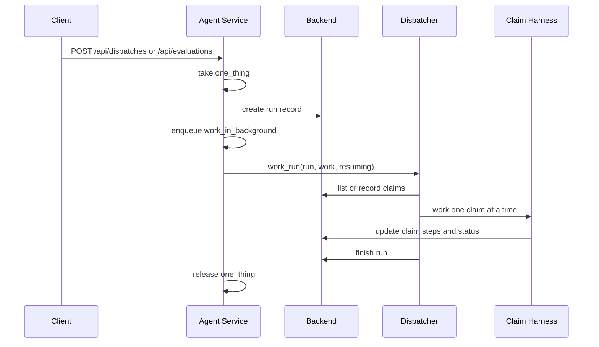
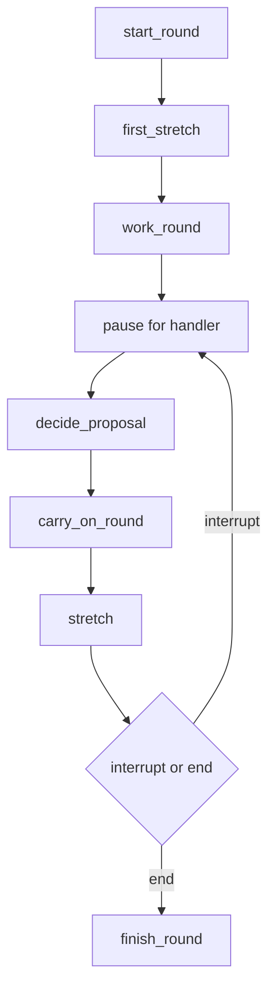

# Agent Service Domain

The agent service is the runtime orchestrator for UnderCover's claim work and improvement work. It is not a package inventory; it is the process that owns the FastAPI API, keeps one long-lived checkpoint pool open, and coordinates three kinds of activity:

- dispatches, which run claims through claim agents;
- evaluations, which are dispatches with a fixed evaluation set;
- improvement rounds, which pause for human approval and later resume.

The service starts with `FastAPI(..., lifespan=lifespan)` in [`agent/service.py`](../../agent/service.py), and `npm run dev` starts it beside the backend and dashboard. On startup it opens the checkpoint pool, stops any runs left active by a previous process, and marks any previously working rounds as stopped so a restart does not leave stale work running.

## Service responsibilities

The service owns the control plane around the worker graphs:

- it creates run records through the backend API;
- it schedules the actual work onto FastAPI background tasks;
- it enforces one-at-a-time gating so only one dispatch, evaluation, or improvement stretch runs at once;
- it resumes claim work after handler sign-off;
- it resumes improvement rounds after handler approval or rejection;
- it propagates backend refusals back to the caller instead of hiding them.

The runtime rule is enforced by `OneThing` in `agent/service.py`. `take()` acquires a process lock and returns HTTP 409 if another unit of work is already active, naming the work already in progress. `release()` always clears the gate when the background task exits, even after failure. The service also tracks claim ids currently being resumed so a dispatch will not pick them up while a sign-off replay is underway.

## Dispatch and evaluation flow

Dispatches and evaluations share the same runtime path. The POST handlers only validate input, acquire the gate, create the backend run record, and enqueue work. The background task then calls `work_in_background()`, which names the run in `one_thing`, invokes the dispatcher, and releases the gate when done.

`work_in_background()` uses `work_run()` from [`agent/dispatcher.py`](../../agent/dispatcher.py) with `harness.work_in_run` bound to the current claim-graph builder. If any exception escapes the run, the service logs the failure and calls `api.stop_runs()`, which turns the failure into a stopped run instead of leaving the backend thinking work is still active.

This diagram shows the dispatch/evaluation lifecycle.

### Dispatcher behavior

The dispatcher in [`agent/dispatcher.py`](../../agent/dispatcher.py) is a LangGraph graph without a model. It:

- selects claims for a run;
- fans them out so each claim gets its own claim agent;
- retries transient model failures with backoff;
- records a report line for each claim;
- finishes the run after all claims come back.

Its selection rules differ by run kind:

- for an evaluation, it uses the run's preselected claims;
- for a dispatch, it reads the backend queue, sorts by submission time and claim id, keeps only claims in `waiting` or `in_progress`, and excludes claims currently marked as resuming.

A failed claim is not treated as a run failure. Transient model rate limits and timeouts get up to three tries and then leave the claim in progress for a later dispatch or resume. Other exceptions are converted into a report line and the run continues. The tests in [`agent/tests/test_dispatcher.py`](../../agent/tests/test_dispatcher.py) verify the fan-out limit, retry behavior, restart continuation, and the case where a claim already started elsewhere is reported instead of retried indefinitely.

## Claim sign-off and resume

When a claim agent reaches a payout that needs human sign-off, the harness interrupts the claim graph and the service exposes `/api/claims/{claim_id}/resume`. That handler checks that the claim is `in_progress` and has a recorded `signed_off_by` decision, then marks the claim as resuming and schedules a background `resume()` call.

The resume path calls `carry_on(claim_id, None, claim_agents.new_graph())`, which restarts the claim graph from a fresh saver-aware graph builder. The `resuming` set keeps dispatches from taking that claim while it is being carried forward. If the resume work fails, the background task still releases the gate so later work can proceed.

The refusal path is important here: the service registers an exception handler for `Refused` and returns the backend's status code and detail as JSON rather than collapsing it into a generic 500. That lets backend refusals propagate cleanly to API callers and to background work that is resumed later.

## Improvement flow

Improvement rounds are the other half of the service. They are started with `/api/rounds` and resumed with `/api/rounds/{round_id}/proposals/{proposal_id}/decision`. Unlike dispatches, a round is not just queue work: it is a LangChain agent that pauses for human approval between proposal steps.

The improver gets a dedicated saver and a function that can build claim agents for any version. `agent/service.py` wires this through `build_improvement()`, producing an `Improvement` object that the round handlers pass into the improver runtime.

The improver in [`agent/improver.py`](../../agent/improver.py) differs from the dispatcher in three important ways:

- it is model-driven and can propose a version or recipe change;
- it pauses on approved proposals and resumes with the recorded human decision;
- it evaluates a proposed version before keeping or rolling it back.

The service's `improve()` helper runs one stretch of the improver and then releases the gate. If the stretch ends because the round was stopped by a handler or the backend refused work, it logs and exits cleanly. If it fails unexpectedly, it stops the round with the error reason. The `carry_on_round()` helper resumes the round after a recorded decision, passing back a reject message when the handler rejected the proposal.

This diagram shows the improvement round lifecycle.

### Why improver and dispatcher differ

The dispatcher is a run orchestrator for claim work: it fans out a finite set of claim agents, records run progress, and finishes. The improver is a controlled agent loop: it reads results, proposes changes, waits for approval, runs evaluations of a candidate version, and then continues with either a new proposal or a finished round.

That difference explains the separate helpers in `agent/service.py`:

- `start_dispatch()` and `start_evaluation()` build runs and hand them to `work_in_background()`;
- `start_round()` and `decide_proposal()` orchestrate the round-specific `improve()` and `carry_on_round()` stretches;
- `resume_claim()` resumes a single claim after sign-off.

## Failure handling and restart behavior

The service is designed to keep state coherent when something fails:

- `OneThing.take()` returns HTTP 409 when a competing request would violate one-at-a-time work gating.
- `resume_claim()` returns HTTP 409 if the claim is not waiting for sign-off or is not currently in progress.
- `work_in_background()` logs any uncaught exception and calls `api.stop_runs()` so a failed run is marked stopped.
- `improve()` logs end conditions for a stopped round and stops the round on unexpected failure.
- `lifespan()` stops any leftover runs and rounds on startup so a fresh process does not inherit half-finished work.

The restart behavior matters because both the dispatcher and the improver persist checkpoints. The checkpoint pool in `agent/harness.py` is opened once per process and shared by the service; the round and claim graphs then build their own savers from that pool so a restart can resume from the last checkpoint instead of starting from scratch.

## Extension points

The service is intentionally small and extensible at the orchestration boundaries:

- change claim selection by editing `agent/dispatcher.py`, not by adding logic to the API layer;
- change claim-agent behavior by editing `agent/harness.py` or `agent/tools.py`;
- change the improvement recipe loop by editing `agent/improver.py`;
- keep service changes focused on gating, scheduling, restart handling, and request validation.

The focused tests that matter most for this page are in [`agent/tests/test_dispatcher.py`](../../agent/tests/test_dispatcher.py) and [`agent/tests/test_improver.py`](../../agent/tests/test_improver.py). They cover concurrency limits, retry behavior, resumption after stop, proposal approval flow, refusal propagation, and the rule that a proposal or evaluation does not take effect until the handler has approved it.
