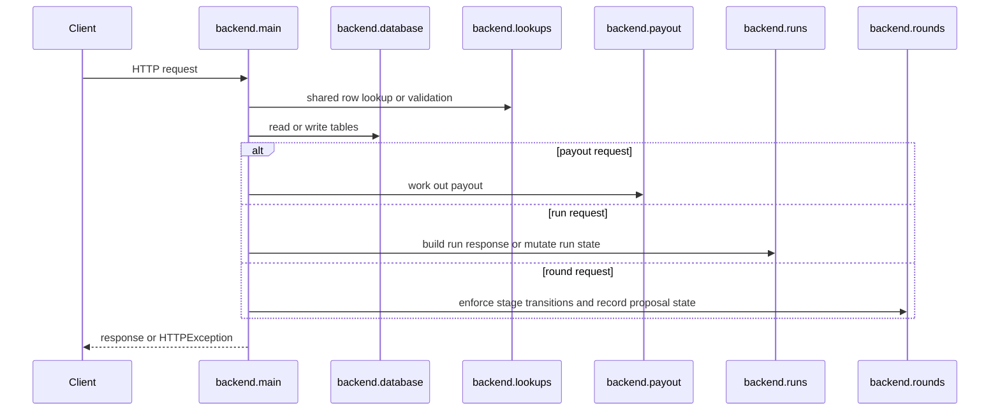
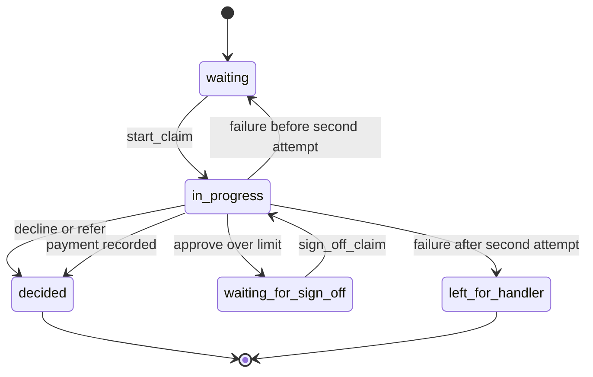
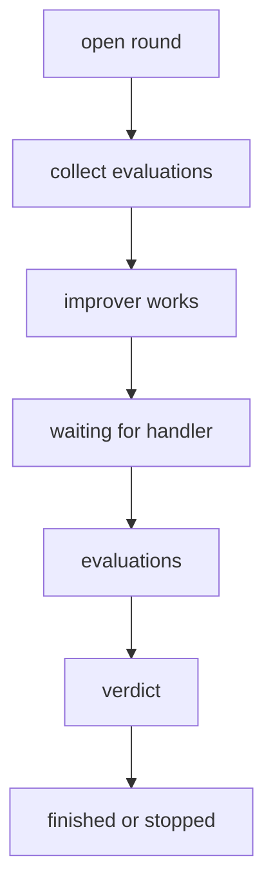

# Backend Domain

The backend is the authoritative application layer for the UnderCover system. It owns the FastAPI API surface, the SQLAlchemy database schema, and the business rules that turn seeded insurance data into claim work, payout calculations, improvement rounds, and run tracking.

It is structured around a few core responsibilities:

- serving claim, policy, customer, document, payout, and handler endpoints;
- persisting the underlying domain state in SQLAlchemy tables;
- enforcing not-found and conflict behavior consistently through shared lookup helpers;
- starting and stopping dispatches, evaluations, and rounds;
- and seeding the database on startup when no tables exist yet.

## High-level request model

`backend/main.py` creates the FastAPI app, mounts the router modules for runs, configuration, platform settings, and rounds, and exposes the claim- and payout-oriented endpoints directly. The startup lifespan checks whether the database is already seeded and calls `seed(engine())` if not.

This diagram shows the common call path: the API layer delegates persistence and state rules to helpers rather than inlining them in every endpoint.

## Database ownership

`backend/database.py` defines the schema and the persistence model. It holds the long-lived tables that the rest of the backend reads and writes:

- configuration tables such as `settings`, `plans`, and `allowed_models`;
- versioning tables such as `recipes` and `agent_versions`;
- round state tables such as `rounds`, `proposals`, and `round_model_calls`;
- document and insurance tables such as `documents`, `handlers`, `customers`, `policies`, and `claims`;
- and operational tables such as `decisions`, `payments`, `steps`, `model_calls`, `work_times`, `runs`, and `grades`.

The same schema is used with Postgres when `DATABASE_URL` is set and with SQLite in tests. That means the backend logic is written once against SQLAlchemy tables and reused across the deployment modes.

A smaller but important invariant is that some data is versioned rather than overwritten. For example, settings, recipes, and agent versions are stored as successive rows, and the lookup helpers intentionally select the newest applicable row when the API needs the current configuration.

## Shared lookup and validation helpers

`backend/lookups.py` centralizes the domain reads that need consistent error handling:

- `run_row`, `round_row`, and `find_version` raise 404 when the requested entity does not exist;
- `current_settings` and `current_version` return the newest active configuration rows;
- `models_allowed` resolves the model list, but switches to the single `MODEL_NAME` free-model path when that environment variable is present;
- `round_left` asks the spending module how much round budget remains;
- and `check_evaluation_goes_on` in `backend/main.py` uses those lookups to reject claim starts when the parent evaluation is no longer running or the round budget is exhausted.

The backend uses a similar pattern for claim and policy access. `find_claim` and `find_policy` both raise 404 with stable messages when the target row is missing. `started_thread` raises 409 if a claim has not yet been started. `check_run` only validates a run when the request references one.

These helpers matter because they keep endpoint code focused on business transitions rather than on repeated existence checks and error strings.

## Claim lifecycle and endpoint groups

The claim endpoints in `backend/main.py` are the main application surface. They cover retrieval, document access, workflow state changes, payout calculation, and payment execution.

- `GET /api/claims` lists non-evaluation claims in id order.
- `GET /api/claims/{claim_id}` returns the full claim record.
- `GET /api/customers/{customer_id}/claims` returns prior claims for a customer.
- `GET /api/policies/{policy_id}` returns policy details.
- `GET /api/documents/search` and `GET /api/documents/{document}/sections/{number}` expose the wording and claims manual.
- `POST /api/claims/{claim_id}/start` moves a waiting claim to in progress and stores the thread id.
- `POST /api/claims/{claim_id}/steps`, `POST /api/claims/{claim_id}/model-calls`, and `POST /api/claims/{claim_id}/work-times` append work evidence once a claim has a thread id.
- `POST /api/claims/{claim_id}/decision` records the decision once.
- `POST /api/claims/{claim_id}/payout` calculates an approval payout without writing anything.
- `POST /api/claims/{claim_id}/payment` records payment for an approved claim.
- `POST /api/claims/{claim_id}/sign-off` records handler sign-off and resumes the claim asynchronously.
- `POST /api/claims/{claim_id}/failure` sends a failed in-progress claim back to the queue, or leaves it for a handler after the second attempt.

The status transitions are owned by the backend, not the agent. `start_claim` only accepts `waiting` claims, `record_decision` only accepts undecided in-progress claims, `pay_claim` only accepts approved claims, and `fail_claim` only accepts in-progress undecided claims. Those checks are what keep the state machine consistent across retries and human intervention.

This lifecycle is intentionally asymmetric: only some transitions are reversible, and sign-off reopens the claim by moving it back to `in_progress` so the agent service can resume work.

## Payout logic

`backend/payout.py` is the backend’s payout engine. It calculates the approved amount step by step from the policy, plans, request lines, and approval limit.

The payout flow applies a fixed ordering of rules:

1. choose the correct plan from the policy;
2. apply line-level limits for items, electronics, hotels, meals, and cash;
3. subtract amounts already paid or refunded by others;
4. apply the deductible when the benefit is deductible-eligible;
5. cap the total at the benefit maximum, with trip cancellation and interruption capped again by trip cost;
6. and never let the final payout fall below zero.

`needs_sign_off` is the small but important gate used by `record_decision` and `pay_claim`: a payout above the current approval limit forces the claim into `waiting_for_sign_off`, and the payment endpoint rejects attempts to pay such claims before handler sign-off.

The payout endpoint itself is read-only. It uses `find_claim`, `find_policy`, `plans_of`, and `approval_limit` to compute the response, but it writes no rows.

## Runs, dispatches, and evaluations

The run subsystem is split across `backend/runs.py`, `backend/run_views.py`, and `backend/new_runs.py`, with `backend/main.py` exposing the service entrypoints that the agent service calls.

`backend/runs.py` owns the dispatch and evaluation lifecycle:

- `POST /api/runs/dispatches` and `POST /api/runs/evaluations` create running runs;
- `PUT /api/runs/{run_id}/claims` records the claim ids for a dispatch;
- `POST /api/runs/{run_id}/finish` finalizes a run, calling the judge for evaluations and storing grades;
- `POST /api/runs/stop` marks every running run stopped;
- `GET /api/dispatches/latest` and the evaluation readers expose the latest run state.

The backend uses separate helpers to ensure run types and statuses are valid before the write happens. `running_run` rejects any attempt to finish or mutate a non-running run, `record_run_claims` rejects non-dispatch runs and unknown claim ids, and `finish_run` protects against races by rechecking the run status both before and after the judge call.

`finish_run` also has a distinctive control-flow boundary: it releases the database connection before calling `judge.grade`, then reopens a transaction to write the results. That keeps the long-running grading step from holding a lock on the database.

## Improvement rounds

`backend/rounds.py` owns the improvement workflow. It tracks rounds, proposals, recipe versions, and round-scoped model calls, and it enforces the stage machine that determines which writes are allowed at any moment.

The important round rules are:

- only rounds in the open set can accept writes;
- some endpoints are only valid in a specific stage, and `require_stage` returns 409 otherwise;
- only one round may be open at a time;
- and stage-dependent responses include progress, spending, and the configuration snapshot captured when the round started.

The round data model is intentionally snapshot-based. A round records the settings and allowed models that were current when it started, so later configuration changes do not rewrite history. `to_round` reconstructs the API response from that stored snapshot and adds the current cost and remaining spending context.

This stage model is the backend’s guardrail for round writes: a request is rejected if it does not belong to the round’s current stage.

## Search and document access

`backend/documents.py` backs the document endpoints. The backend stores the wording and manual sections in the `documents` table, and the API exposes them in two ways:

- `search(db, query)` returns section matches with excerpts;
- `sections(db, document)` and `titles(db)` reconstruct a full section or document title when a client asks for a specific section.

This is a read-only surface, but it is still part of the domain model because payout calculation and claim review depend on the policy wording and claims manual as source material.

## Startup seeding and operations

Startup seeding happens in the FastAPI lifespan handler. On application start, the backend checks `is_seeded(engine())`, and if the database has no tables yet it calls `seed(engine())` before serving requests.

The `backend.seed` entrypoint is the same seeding logic exposed as a standalone command. It rebuilds the database from the repository data files and prints the number of seeded claims, policies, customers, handlers, held-out claims, and handler decisions.

That means the backend has a clear operational contract:

- a fresh database is populated automatically on app startup;
- seeded data is the canonical source for tests and local runs;
- and the same schema and helpers work for both SQLite test runs and the Postgres deployment.

## Focused tests that matter

The test coverage that is most relevant to this page is the OpenAPI check in `backend/tests/test_openapi.py`. It verifies that the generated API description follows the repository’s API rules, which makes endpoint shape a first-class contract rather than an implementation detail.

That test is useful here because the backend domain is defined not only by business rules, but also by how those rules are surfaced through the API. A change that accidentally weakens the API contract should fail there before it reaches users.

## Architectural summary

The backend owns the system’s authoritative state transitions and persistence boundaries. Claims, policies, runs, rounds, decisions, payments, and documents all flow through one of two patterns:

- a read path that reconstructs domain objects from SQL tables and JSON blobs;
- or a write path that validates the current state, applies a transition, and records an audit trail row.

The most important invariant across the module set is that the backend, not the caller, decides whether a request is allowed. That is why 404 and 409 behavior is centralized in helpers, why stage checks are repeated before writes, and why payout and sign-off logic are enforced inside the API layer instead of being left to clients.
