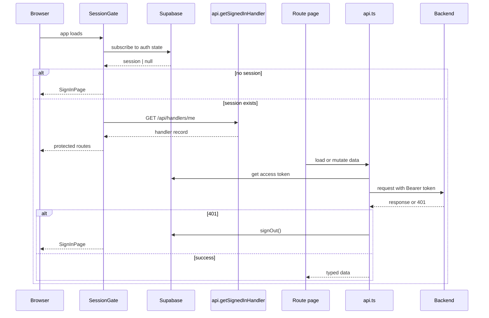

# Dashboard Domain

The dashboard is the browser-facing workflow surface for UnderCover. It does not own business rules; instead, it composes route-driven pages that let a signed-in handler move through claim review, score exploration, evaluation detail, configuration, improvement rounds, and personal settings.

The key architectural boundary is that every interactive page is wrapped by a session gate. A browser session is established through Supabase Auth, the authenticated handler identity is fetched from the backend, and page code then uses a shared API client that attaches the current Supabase access token to backend requests.

## Route groups and page responsibilities

The top-level app defines the dashboard as a small set of stable routes:

- `QUEUE` (`/`) for the claim queue and dispatch-oriented work;
- `CLAIM_PAGE` (`/claims/:claimId`) for a single claim’s workflow and thread details;
- `SCOREBOARD` (`/scoreboard`) for run and evaluation overviews;
- `EVALUATION_PAGE` (`/scoreboard/:runId`) for a single evaluation’s scored run details;
- `CONFIGURATION` (`/configuration`) for version and settings configuration;
- `IMPROVEMENT` (`/improvement`) for round lifecycle and recipe review;
- and `SETTINGS` (`/settings`) for the signed-in handler’s own preferences and account-adjacent controls.

The navigation mirrors those route groups, while the queue link is also treated as active when the user is on an individual claim page. That keeps claim-detail work visually anchored to the queue workflow rather than making it look like a separate area.

## Session gating and identity flow

`SessionGate` is the outer control point for the whole app. It subscribes to Supabase Auth state changes, starts in an indeterminate loading state, and then renders one of three outcomes:

1. a loading message while the session is unknown;
2. the sign-in page when there is no active session;
3. or the protected dashboard when a session exists.

When a session is present, `SessionGate` immediately loads the signed-in handler with `api.getSignedInHandler`. That extra round trip matters because the dashboard does not trust the browser session alone for UI identity; the backend still decides which handler record is associated with the token. If that lookup fails, the gate renders the error state and offers sign-out as a recovery path.

The `SignedInHandler` context then makes the handler available to any page inside the gate through `useHandler()`. Pages such as the header sign-in badge depend on that context to show the handler name and role, and `useHandler()` throws if it is called outside the protected tree. That invariant prevents silently rendering protected UI without a verified handler.

## Shared client abstractions

Only a few shared abstractions shape safe UI changes across the dashboard:

- `supabase.ts` owns the single Supabase client, the session storage key, sign-in/out, auth-state subscription, and access-token lookup.
- `api.ts` owns the HTTP transport to backend endpoints and is the only code that should know how tokenized requests, timeout handling, and sign-out-on-401 behavior work.
- `session.ts` owns the signed-in-handler context and the guard that keeps authenticated page code from running without a handler.
- `paths.ts` owns canonical route patterns and route-link helpers so navigation and route matching stay consistent.

`api.ts` is especially important because it converts the Supabase session into backend authorization. Before each request, it fetches the current access token and sends it as `Authorization: Bearer ...` when available. If the backend responds with `401`, the client signs the user out locally, which returns the app to the sign-in flow instead of leaving the UI in a stale authenticated state. Requests also time out after 30 seconds so a hung backend call does not block page refreshes forever.

## Backend-intersection points

The dashboard’s pages are thin orchestration layers over backend resources:

- the queue page loads claim summaries and refreshes periodically;
- the claim page loads a single claim, its steps, policy details, and customer claim history;
- the scoreboard page loads recent evaluations and can start new evaluations;
- the evaluation page loads the scored evaluation for a specific run;
- the configuration page lists versions and loads individual version detail, including diffs and scores;
- the improvement page lists rounds, the current settings, and recipes, and can start, stop, or decide round proposals;
- and the settings page loads the current settings and available models, then updates settings through the API.

Those page workflows reflect the backend shape directly, but the dashboard keeps the API surface centralized so UI changes remain compatible with token handling, error normalization, and auth recovery.

## Request and lifecycle flow

## Invariants and failure behavior

Several failure paths are deliberate and user-visible:

- if Supabase has not yielded a session yet, the app waits instead of guessing;
- if a session disappears, the app returns to sign-in rather than trying to render protected pages;
- if the backend says the token is no longer valid, the dashboard signs out locally;
- if the handler lookup or any data fetch fails, pages surface the error through the shared message/loading pattern rather than hiding it;
- and if a route does not match any known page, the app shows a not-found message.

These rules keep the dashboard consistent with the authenticated backend state and make it safer to extend pages without accidentally bypassing identity checks.

## Extension points that matter

When changing the dashboard, the safest extension points are:

- add or rename routes in `paths.ts`, then update `App.tsx` navigation and `<Routes>` together;
- add backend calls in `api.ts` so token handling and timeout behavior stay centralized;
- fetch handler identity only through `useHandler()` inside `SessionGate`;
- and keep page workflows narrow, with each page responsible for one backend-aligned task family instead of broad cross-page state.

Focused tests already exercise the important edges around routing, session recovery, and page behavior in `App.test.tsx`, `Session.test.tsx`, `api.test.ts`, and the route-specific page tests. Those are the tests that matter most when changing protected navigation or request flow.
