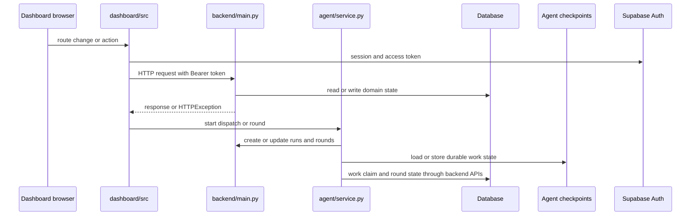

# Architecture Overview

UnderCover has three user-facing runtime pieces and one shared persistence layer:

- the **backend API** is the authoritative application layer for claims, payouts, runs, rounds, documents, and handler identity;
- the **agent service** is the separate FastAPI process that orchestrates dispatches, evaluations, claim resumes, and improvement rounds;
- the **dashboard** is the browser UI that authenticates handlers and drives backend work through a tokenized API client;
- and **persistent state** lives in the backend database and the agent checkpoint pool.

The main architectural boundary is that the backend owns domain truth, the agent service owns work orchestration, and the dashboard owns user interaction. Each layer calls the next one down through a narrow API instead of sharing implementation details.

## Runtime topology

This diagram shows the smallest complete system map: the browser never talks to the database directly, the agent service never owns domain state directly, and the backend is the shared authority for durable business records.

## Component responsibilities

### Backend API

The backend is the system of record. It exposes the claim, policy, document, payout, run, round, configuration, and handler endpoints, and it seeds the database on startup when no tables exist yet. It also enforces the business transitions that keep claims and rounds valid, including 404 and 409 behavior for missing rows, invalid state, and exhausted round budget.

Important operational boundaries:

- it is the only layer that writes canonical domain rows such as claims, decisions, payments, runs, and rounds;
- it exposes the signed-in handler record through `/api/handlers/me`, which the dashboard uses to verify identity;
- and it owns the request checks that decide whether a claim may start, resume, or pay.

### Agent service

The agent service is a separate FastAPI process started alongside the backend and dashboard during local development. It does not replace backend rules; instead, it coordinates long-running or asynchronous work on top of them.

Its responsibilities are:

- create run records through the backend and execute dispatches and evaluations in background tasks;
- resume a single claim after handler sign-off;
- start and continue improvement rounds after handler decisions;
- enforce one-at-a-time gating so only one dispatch, evaluation, or round stretch runs in the process at once;
- and keep restart behavior safe by stopping leftover runs and rounds when the process comes up.

The agent service owns its checkpoint pool for durable orchestration state. That pool is opened once per process and shared by claim and round graphs, which is what makes resume behavior possible after a restart.

### Dashboard UI

The dashboard is a React application that renders route-driven pages for queue, claim detail, scoreboard, evaluation detail, configuration, improvement, and settings. It is intentionally thin: the pages are orchestration surfaces over backend resources, not places where business rules live.

Its key control boundary is `SessionGate`:

1. wait while the Supabase session is unknown;
2. show sign-in when no session exists;
3. fetch the signed-in handler from the backend when a session exists;
4. render protected routes only after that lookup succeeds.

The shared API client converts the Supabase access token into backend authorization, signs the user out locally on `401`, and times out hung requests so the UI does not get stuck.

### Persistent state

There are two persistence mechanisms with different jobs:

- the **backend database** stores the authoritative application state: claims, policies, customers, documents, decisions, payments, runs, rounds, versions, and supporting tables;
- the **agent checkpoint pool** stores orchestration state for LangGraph and LangChain work, so the agent service can resume a claim or round after a pause or restart.

A safe change usually needs to know which store owns the state being touched. If the data is part of the business record, the backend owns it. If the data exists to resume orchestration, the agent service owns it.

### External integrations

The main external integrations are:

- **Supabase Auth**, which issues the browser session and access token used by the dashboard;
- **Supabase/Postgres**, which provides the backend database in deployment and the Postgres checkpoint pool for the agent service;
- and the backend itself, which is the integration target for both the dashboard and the agent service.

## Request and process boundaries

The safest way to think about the system is by boundary:

- the dashboard can request work, but it cannot invent state transitions;
- the agent service can orchestrate work, but it cannot bypass the backend's rules for claims, runs, and rounds;
- and the backend can change durable business state, but it does not run the browser session or the agent background loops.

That separation matters for debugging. If a user-facing action fails, check the dashboard client and auth flow first; if the domain transition is rejected, check backend validation; if a run or round is stuck, check the agent service gate, restart handling, and checkpoint-backed resume path.

## Focused extension guidance

When extending the system, keep changes in the layer that owns the behavior:

- change API shape, validation, or persistence rules in the backend;
- change dispatch, evaluation, or round orchestration in the agent service;
- change route composition, session gating, or request transport in the dashboard;
- and change storage or integration wiring only when the ownership of state actually changes.

The most important invariant is that cross-layer changes should preserve the same source of truth. The dashboard should not become a second business rule engine, and the agent service should not become the owner of durable claim or round records.
