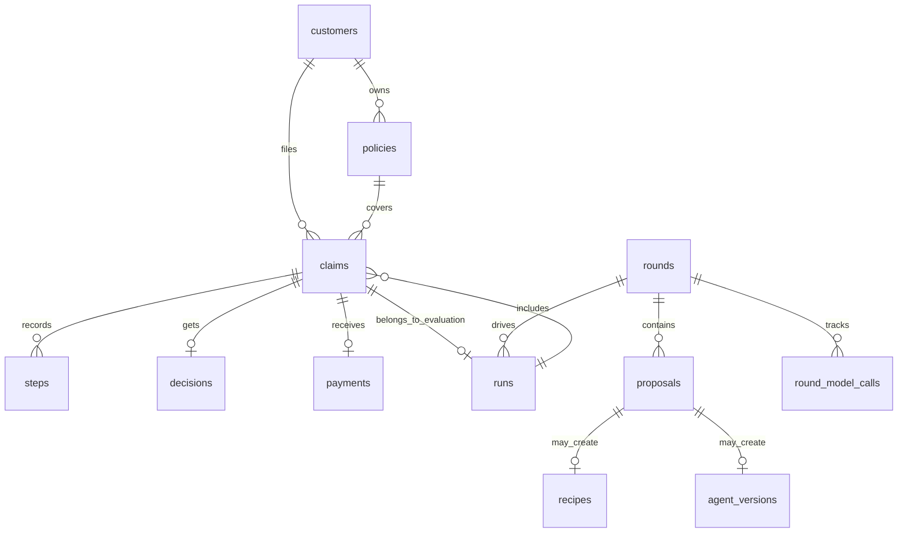
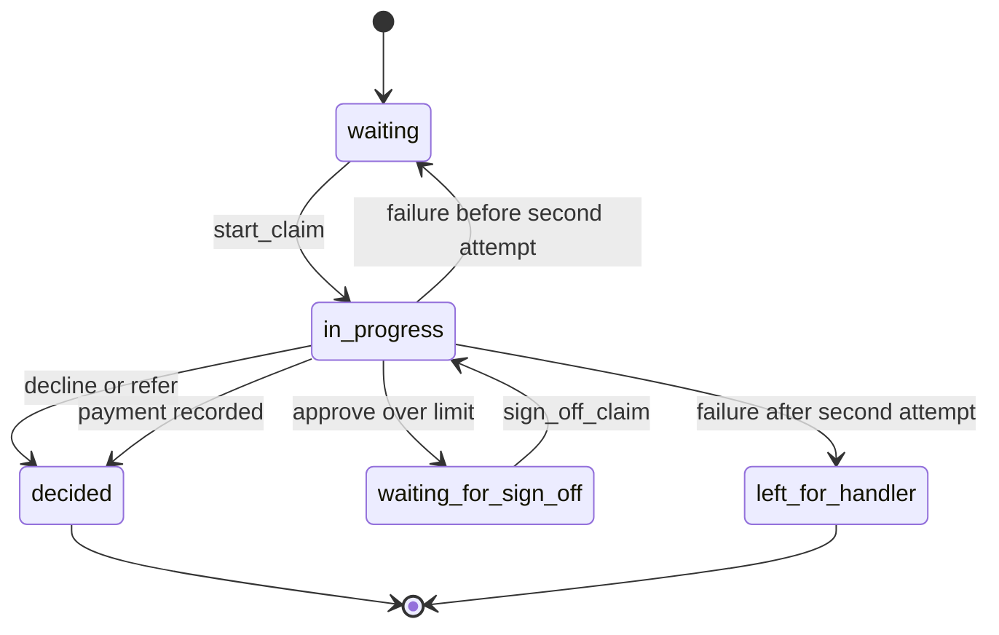

# State and Data Model

This page summarizes the system's core domain objects and the state transitions that tie them together. The backend owns the durable records and the rules that decide when a claim, run, or round may move forward; the dashboard and agent services only trigger those transitions through API calls.

The main entities are:

- **Customer**: the insured person or account holder tied to one or more policies and claims.
- **Policy**: the insurance contract and trip context used for review and payout calculation.
- **Claim**: the work item the agent reviews, including its status, thread, evaluation copy relationship, decision, and payment.
- **Step**: a timestamped record of claim work such as messages, tool calls, tool results, readings, and errors.
- **Decision**: the recorded claim outcome, with reason, section citation, payout, and optional sign-off metadata.
- **Payment**: the actual payout record for an approved claim.
- **Run**: a tracked dispatch or evaluation execution over claims.
- **Round**: an improvement cycle for the claim agent, with a stage machine, captured configuration snapshot, and proposal history.
- **Evaluation**: a run whose purpose is to score the current version or a candidate version.
- **Proposal**: a round-scoped change or recipe request that a handler may approve or reject.

The model is intentionally split between persistent rows and API reconstruction helpers. The database stores the raw state, while the backend turns those rows into response objects and enforces which subsystem may update each field.

## Entity relationships

This diagram shows the main storage relationships, not every foreign key. A claim can be copied into an evaluation run, a round can emit proposals and model-call cost records, and a successful round may produce a new recipe or agent version.

## Claim lifecycle

A claim is the main workflow object. Its status is stored in the backend and only changes through backend operations, not by the dashboard or agent directly.

Claim statuses are:

- `waiting`
- `in_progress`
- `waiting_for_sign_off`
- `decided`
- `left_for_handler`

The backend methods own the transitions:

- `start_claim` accepts only `waiting` claims, sets `thread_id`, increments `attempts`, and moves the claim to `in_progress`.
- `record_step`, `record_model_call`, and `record_work_time` only work after a claim has a `thread_id`, so they attach work evidence to a started claim.
- `record_decision` accepts only an undecided `in_progress` claim and creates exactly one decision row.
- `pay_claim` accepts only approved claims, rejects payments that do not match the approved payout, and writes the payment row once.
- `sign_off_claim` updates the stored decision with handler sign-off metadata, reopens the claim as `in_progress`, and tells the agent service to resume it.
- `fail_claim` accepts only undecided `in_progress` claims and either sends the claim back to `waiting` or leaves it with a handler after the second attempt.

The important invariant is that the backend, not the caller, decides whether a transition is legal. Attempts to skip a state or repeat a write with different data are rejected with 409 or 403 responses, while idempotent retries with the same data are allowed when the record already exists.

## Decision and payment relationship

A decision and a payment are related but not the same thing.

- `Decision` captures the reviewer outcome: `approve`, `decline`, or `refer`.
- `Payment` captures the money actually recorded against an approved claim.

The backend keeps those records separate so an approved claim can exist before it is paid, and so a sign-off flow can add handler approval metadata before payment happens. For approved claims, the payout stored in `decisions` must match the payout later written to `payments`.

A decision row may also carry sign-off metadata:

- `signed_off_by`
- `signed_off_at`

Those fields are only populated when an over-limit approval is signed off by a handler who can approve over the limit. Once sign-off is recorded, the backend resumes the claim by moving it back to `in_progress`.

## Run and evaluation model

Runs represent tracked executions of the claim agent or evaluation service. The backend distinguishes:

- `dispatch` runs, which work through claim queues;
- `evaluation` runs, which score a claim-agent version against a labeled set.

Run status is tracked separately as:

- `running`
- `finished`
- `stopped`

A run record stores the version, model, reasoning effort, agents, status, timestamps, and cost context. Dispatch runs also carry summary data about approved, declined, referred, waiting-for-sign-off, left-for-handler, and unfinished claims. Evaluation runs additionally carry an evaluation set, a tiny/full flag, and scoring measures.

Evaluation copies are linked back to their source claims through `copy_of` and `evaluation_id` on the claim record. That lets the dashboard and backend show scored copies side by side with the handler decision that the evaluation is judged against.

The backend protects the run lifecycle in a few ways:

- only running runs may be mutated or finished;
- evaluation finishing rechecks status around the judge call to avoid races;
- and long-running grading is done outside the database transaction so the database is not held while the judge works.

## Round and proposal model

Rounds are the improvement workflow that updates the claim agent itself. A round captures a snapshot of the settings and allowed models that were current when the round started, so later configuration changes do not rewrite the round's history.

Round stages include:

- `first_evaluations`
- `improving`
- `waiting_for_change`
- `evaluations`
- `verdict`
- `waiting_for_recipe`
- `finished`
- `stopped`

The backend uses the stage machine to decide which writes are legal. Some endpoints are only valid in specific stages, and a write is rejected with 409 if it does not belong to the round's current stage. Only one round may be open at a time.

Rounds own several related records:

- `proposals`, which represent change or recipe suggestions and the handler review decision on them;
- `round_model_calls`, which accumulate the cost of improver model usage;
- and `agent_versions` or `recipes`, which may be produced from an approved proposal.

A round's evaluation state is also tied to the runs it launches. The backend tracks progress from the number of required evaluations that have started or finished, and it records the round verdict after the comparison run has completed.

## Persistence and ownership boundaries

A useful way to read the model is by ownership:

- **Dashboard**: displays and initiates workflows, but does not own state.
- **Agent service**: records work evidence and resumes claims when the backend asks it to.
- **Backend**: owns all durable state changes and status validation.
- **Database**: stores the canonical rows.

This division matters because many fields are write-once or effectively append-only. Steps, model calls, work times, decisions, payments, proposals, and round model calls are appended as evidence. Status fields and sign-off fields are changed only by the backend endpoints that own that lifecycle.

## Operational implications

The model is implemented against the same SQLAlchemy tables in SQLite tests and in Postgres when `DATABASE_URL` is set. That makes the state transitions portable across local runs and deployment.

The most important change-safety rules are:

- status checks happen before writes;
- decision and payment rows must agree on the approved payout;
- evaluation copies stay linked to the source claim;
- round snapshots preserve historical settings and allowed models;
- and conflict behavior is centralized so callers get stable 404 and 409 responses.

When changing this area, update the backend transition logic together with the schema and the API responses that reconstruct these objects. The data model is not just a set of tables; it is the contract that keeps claim review, payouts, evaluation scoring, and improvement rounds aligned.
