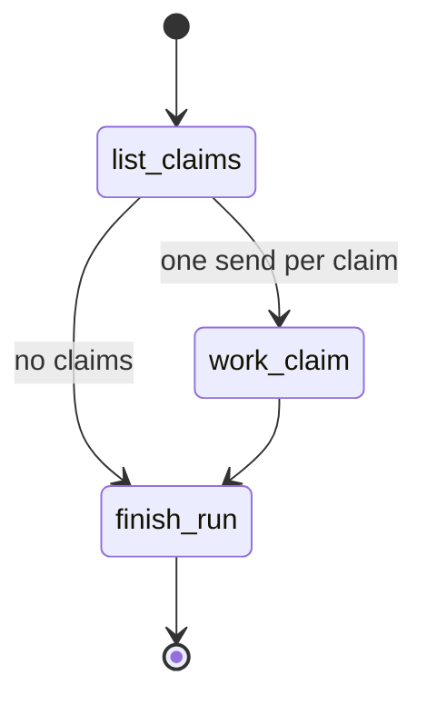
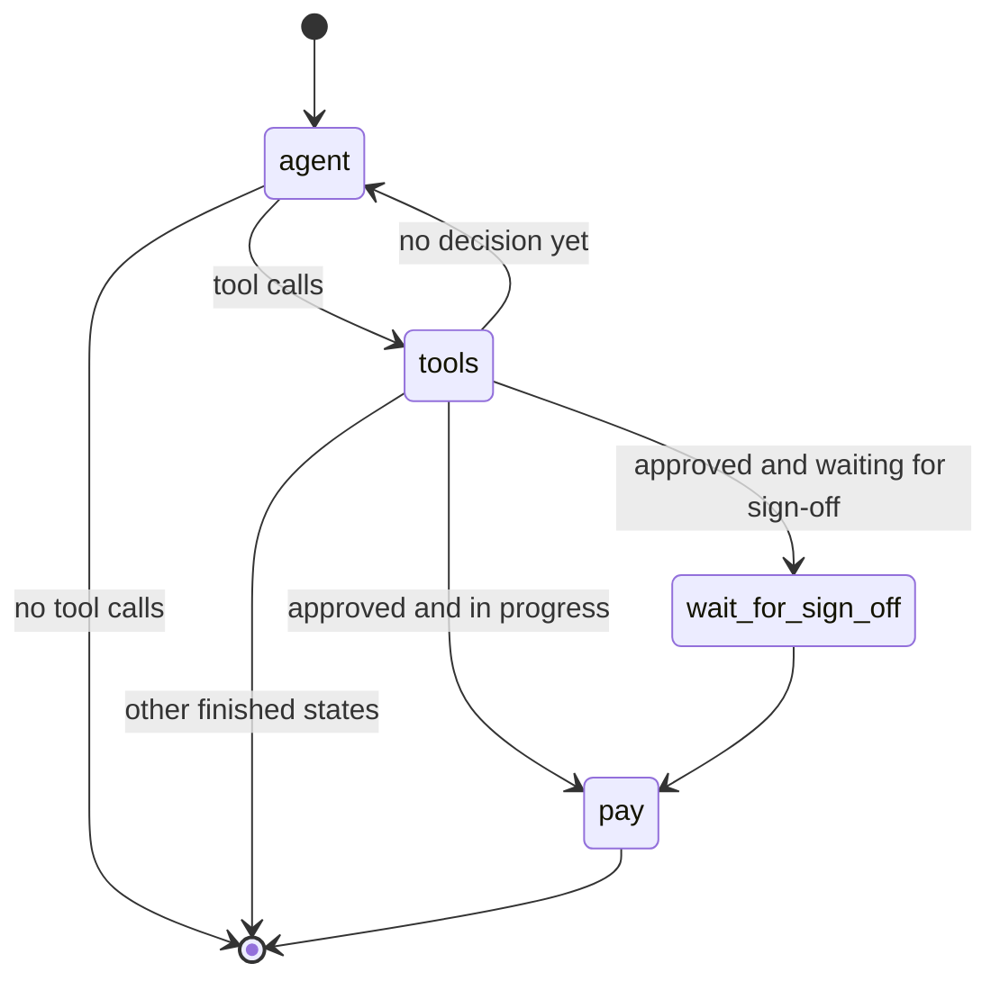

# LangGraph and Checkpointing

The agent service uses LangGraph for two different execution models:

- the **dispatcher** graph, which fans a dispatch or evaluation out to many independent claim workers and does not persist graph state;
- the **claim** graph and the **improver** round flow, which persist progress in a checkpoint store so work can resume after a pause, a crash, or a service restart.

The practical rule is simple: the backend remains the source of truth for claim, run, and round records, while LangGraph checkpoint storage keeps the last resumable graph state for a specific thread.

## Runtime structure

### Dispatcher graph

The dispatcher is a small LangGraph state graph with three nodes:

1. `list_claims` chooses the work list.
2. `work_claim` hands each claim to a claim agent.
3. `finish_run` closes the run after all claim reports return.

It uses `Send` from the conditional fan-out node so each claim is processed as its own LangGraph branch, and it sets `max_concurrency` from the run record so the backend-defined agent limit controls parallelism. The graph itself is not compiled with a checkpointer; the dispatcher is meant to finish a run in one pass.

This diagram shows the dispatcher flow: it selects claims, fans them out, and then finishes the run.

### Claim graph

The claim agent graph is compiled with a checkpoint saver and saves after every step. Its structure is:

- `agent` calls the model and records the reply and model-call cost.
- `tools` runs the tool calls the model requested.
- `wait_for_sign_off` pauses at the sign-off boundary.
- `pay` records an approved payment.

The graph loops between `agent` and `tools` until the model records a decision. If the decision is an approval and the claim is still in progress, the graph goes through the pause and payment path; otherwise it ends.

This diagram shows the claim graph lifecycle and where checkpointed progress can be resumed.

### Improver round flow

The improver is another LangGraph-backed flow, but it is managed by the service as a background round with human approval points. The service builds the improver with a checkpoint saver from the same pool, and the round can be resumed after a handler accepts or rejects a proposal.

The service also serializes dispatches, evaluations, and rounds with a single-process lock so only one of those top-level activities runs at a time.

## Checkpoint storage

The claim graphs and improver rounds use `PostgresSaver` on a connection pool created by `checkpoint_pool()` in `agent/harness.py`.

Important details:

- the pool is opened from `DATABASE_URL` with bounded concurrency and a wait timeout;
- the service creates the `undercover` schema if needed and then calls `PostgresSaver(pool).setup()` to initialize checkpoint tables in that schema;
- the graph checkpoints are stored in Postgres, not in memory, so progress survives process restarts;
- claim graphs are compiled with `durability="sync"` when invoked, which means each step is written before the graph advances.

This is not the same as the backend database records. The backend stores claim status, decisions, run membership, round state, and payment metadata. The checkpoint store holds the graph thread state needed to continue execution from the right node and with the right saved values.

## What is resumed vs reconstructed

On restart, the service does **not** replay the whole run from checkpoints alone.

### Resumed from checkpoint storage

LangGraph checkpoint state provides:

- the thread identity for a claim graph or improver round;
- the saved graph values, including message history and other node state;
- the next node to execute;
- whether the graph paused at the sign-off interrupt or stopped after a step write.

The claim resumption helper checks the saved thread state and chooses how to continue:

- if the next node is the pause node, it resumes with `Command(resume=True)`;
- if nothing was saved yet and the claim still has no decision, it starts the graph on a fresh first message;
- otherwise it continues from the saved state on the same thread.

### Reconstructed from the backend

The backend is queried again to rebuild runtime context around the checkpointed thread:

- `work_run` reconstructs the run, the work function, and the set of claims that are being resumed after sign-off;
- `current_claim_agents` reconstructs the active model version and build settings from the current backend version record;
- `claim_agents_of(version, pool)` reconstructs the claim graph factory from the backend version configuration;
- `carry_on_round` and the improver tools reconstruct the round record, proposal status, and verdict from backend state before resuming the improver.

This means the persisted graph state is necessary but not sufficient: the backend determines what the current work means, while the checkpoint tells LangGraph where to continue.

## Restart semantics

A service restart changes the runtime environment, but not the stored backend records or checkpointed graph threads.

When the FastAPI app starts, its lifespan handler:

1. opens the checkpoint pool;
2. marks any run that an earlier service left running as stopped;
3. marks any active improver rounds as stopped with the restart reason.

That reset is important because the new process cannot assume the old in-memory lock or background task still exists. After restart:

- a dispatch or evaluation already in flight is treated as stopped and will not continue as a live run;
- a claim that had saved checkpoint progress can still be resumed, but only through a new request path that reconstructs the proper graph and context;
- a round interrupted by the restart is stopped in the backend and must be started or resumed again through the service.

In practical terms, this prevents two service instances from both believing they own the same in-progress work.

## Retries and failure handling

The dispatcher node `work_claim` has a `RetryPolicy` for transient model failures such as rate limits and timeouts. It retries those errors up to three attempts with backoff, and each retry continues the same claim work rather than aborting the whole dispatch.

If the last retry still fails, the dispatcher records a report line and lets the rest of the dispatch continue. The claim graph itself also preserves progress on transient failures so a later resume can continue from the saved step instead of starting over.

A few consequences follow from that design:

- transient model errors do not stop the whole dispatch;
- non-transient errors are converted into a report line for that claim;
- a claim may be left `in_progress` for a later dispatch if it still has recoverable saved state;
- the graph checkpoint ensures a later resume continues from the last completed step, not from the beginning.

## Operational impact

Checkpointing changes the behavior seen by operators and handlers:

- claim processing can survive a crash in the middle of a claim step, because the saved thread state still exists;
- a claim that has reached sign-off can be resumed without re-running already completed model calls or tool steps;
- an approval decision made before a restart is not lost, because the backend records the decision separately from the graph thread;
- if a service restarts before resuming an interrupted round, the round is marked stopped and must be resumed through the backend and service again;
- dispatches never resume from checkpoint storage as a whole; they reconstruct their claim list from the backend and then resume each claim graph individually as needed.

## Extension boundaries

The key extension point is the graph boundary, not the checkpoint store.

- If you add nodes to the claim graph, they must remain compatible with the saved thread state and the resume path.
- If you change what the backend records for a run, claim, or round, you may also need to update the reconstruction logic that builds `DispatchContext` or `ImproverContext`.
- If you introduce a new resumable graph, it should follow the same pattern: keep durable thread state in LangGraph, keep authoritative business state in the backend, and make restart behavior explicit in the service startup path.

## Related tests

The repository tests document the important semantics:

- `agent/tests/test_dispatcher.py` checks dispatcher fan-out, retry policy, resumable dispatch behavior, and the fact that a claim left mid-run is finished by the next dispatch.
- `agent/tests/test_restart.py` exercises claim resumption after interrupted checkpoints, including the case where a step is written but the checkpoint has not yet been saved.
- `agent/tests/test_service_rounds.py` verifies that service startup stops prior working rounds and that sign-off resumption is serialized against other work.

These tests matter because they pin down the contract between backend state, checkpoint persistence, and the service’s restart behavior.
