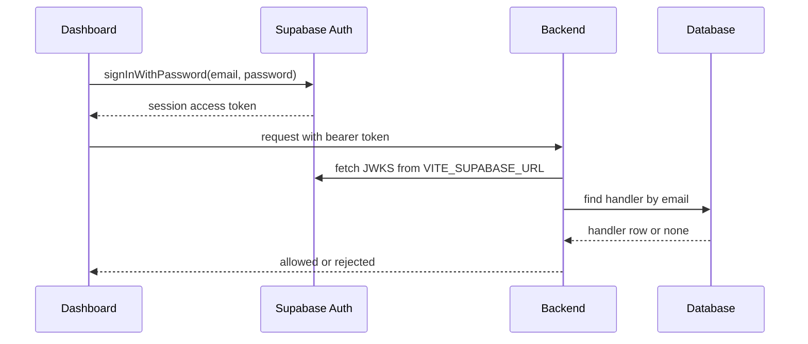

# Supabase and External Services

UnderCover uses Supabase as two separate external contracts:

1. **Supabase Auth** for dashboard sign-in and backend authentication checks.
2. **Supabase Postgres** for the shared application database and durable agent checkpoints.

The repo does not treat Supabase as a single monolithic dependency. Each subsystem owns its own integration point, environment variables, and failure handling, so the behavior differs depending on which service is unavailable.

## Ownership by subsystem

- **Dashboard** owns the browser-facing sign-in flow. It creates a `supabase-js` client from `VITE_SUPABASE_URL` and `VITE_SUPABASE_PUBLISHABLE_KEY`, stores session state under `undercover-session`, and signs handlers in and out with Supabase Auth.
- **Backend** owns token verification. It validates the access token against Supabase Auth's published public keys, then looks up the handler by email in the database.
- **Backend database layer** owns the Postgres connection. It uses `DATABASE_URL` when present, otherwise SQLite, with the same SQLAlchemy Core tables and queries in both modes.
- **Agent service** owns checkpoint storage for LangGraph and resumes work using the same database pool as the backend.

## Sign-in flow

The dashboard signs handlers in with `@supabase/supabase-js` and `signInWithPassword`. The client reads the public Supabase URL and publishable key from Vite environment variables, which means the values must be present at build time for the dashboard to talk to the correct project.

After sign-in, the dashboard keeps the session in the browser and sends the access token with backend requests. The backend does not trust the browser session directly; it extracts the bearer token, fetches the project's JSON Web Key Set from `VITE_SUPABASE_URL/auth/v1/.well-known/jwks.json`, verifies the token's issuer and audience, and requires both `exp` and `email` claims. It then matches the email against the `handlers` table.

If the token is missing or invalid, the backend returns `401`. If the email is valid but does not belong to a known handler, it returns `403`. If Supabase Auth's keys cannot be fetched, it returns `503`.

Caption: the dashboard signs in through Supabase Auth, while the backend independently verifies the returned JWT and resolves the handler from the database.

## Database and checkpoint storage

When `DATABASE_URL` is set, the backend uses the Supabase Postgres database through SQLAlchemy and psycopg. The same code path also backs the agent's LangGraph checkpoint store, so the agent's long-running work survives process restarts.

The database layer is intentionally portable:

- with `DATABASE_URL`, it connects to Postgres in the `undercover` schema;
- without `DATABASE_URL`, it falls back to SQLite, which is what the tests use;
- the SQLAlchemy tables and query structure stay the same in both cases.

This means local tests do not need network access, while development and production can point at Supabase by setting one environment variable.

For the agent service, the checkpoint pool is opened during application lifespan startup and kept available until shutdown. On startup, the service also marks previously running work as stopped, so stale in-progress runs do not survive a restart as if they were still active.

## Environment variables that change behavior

### Dashboard

- `VITE_SUPABASE_URL`: Supabase project URL used by `dashboard/src/supabase.ts`.
- `VITE_SUPABASE_PUBLISHABLE_KEY`: public key used by the dashboard client.

If either value is wrong, the dashboard cannot sign in. In development, Vite reads these values from the repo root environment; in build systems they must be injected into the dashboard build.

### Backend authentication

- `VITE_SUPABASE_URL`: used by `backend/auth.py` to derive the JWKS URL and issuer.

If this value is missing, the backend falls back to `http://127.0.0.1:54321`, which is a local stand-in address used by tests.

### Database and checkpoints

- `DATABASE_URL`: selects Postgres on Supabase instead of SQLite and is also used by the agent checkpoint pool.
- `UNDERCOVER_DB`: optional SQLite file path when `DATABASE_URL` is unset.

If `DATABASE_URL` points at Supabase, the backend and agent must be able to reach the database network endpoint. When it is absent, the app still works locally, but persistent state is isolated to the local database file.

## Failure modes and propagation

Supabase failures do not all fail the app in the same way:

- **Auth unreachable:** backend sign-in verification fails with `503`, because the JWKS cannot be fetched.
- **Bad or missing token:** backend rejects the request with `401`.
- **Token belongs to no handler:** backend rejects the request with `403`.
- **Database unreachable:** backend requests that need state fail when SQLAlchemy cannot connect, and the agent cannot save or resume checkpoints.
- **Wrong dashboard environment:** sign-in cannot start, because the client is created with the wrong project URL or publishable key.

Because the dashboard and backend verify different parts of the same login flow, an outage in one service often appears as a different error in each layer. For example, a bad dashboard configuration prevents sign-in entirely, while a broken JWKS fetch still allows the browser to attempt sign-in but causes the backend to reject the request.

## Operational notes

The important deployment invariant is that the dashboard build and the backend runtime must agree on the Supabase project. The dashboard reads its values from Vite environment variables, while the backend reads its own environment at process start. Changing the project URL or publishable key requires rebuilding the dashboard; changing `DATABASE_URL` changes the backend's persistence target immediately for a fresh process.

For local development, the repo can run entirely without Supabase Postgres by omitting `DATABASE_URL`. Supabase Auth is still only required if you want the browser sign-in path to hit a real project instead of a stand-in or test fixture.

## What this page does not cover

This page documents the Supabase integration points that the code actually uses. It does not describe unrelated hosted services, model providers, or the broader runtime deployment setup, which are covered on other architecture and operations pages.
