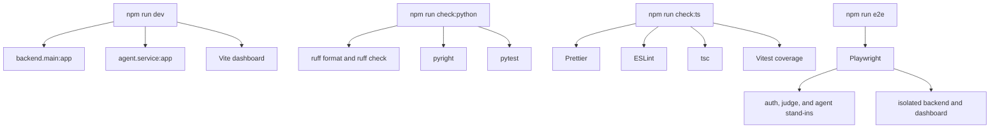

# Development and Verification

This repository is organized around three local workflows:

1. a Python backend and agent service run with `uv` and `uvicorn`,
2. a TypeScript dashboard built with Vite and checked with ESLint, Prettier, TypeScript, and Vitest, and
3. Playwright end-to-end checks that spin up their own isolated services instead of relying on the developer shell.

The main package manifests and the root README define the supported commands. The testing setup in `conftest.py`, `playwright.config.ts`, and `dashboard/src/test_setup.ts` shows how the repo keeps unit and browser checks isolated from external services.

## Local development entrypoints

The root `package.json` is the main convenience layer for local work:

- `npm run dev` starts the backend, agent, and dashboard together.
- `npm run dev:backend` runs `backend.main:app` with reload support.
- `npm run dev:agent` runs `agent.service:app` on port `8002` with reload support.
- `npm run dev:dashboard` starts the Vite dashboard.
- `npm run seed` seeds the backend database.
- `npm run format` formats Python and TypeScript sources.
- `npm run check` runs the full verification stack.
- `npm run check:python` runs Python formatting, linting, type checking, and tests.
- `npm run check:ts` runs dashboard and browser-adjacent formatting, linting, type checking, and Vitest.
- `npm run e2e` runs Playwright.

The README also describes the project’s day-by-day workflows and notes that `uv run monitor.py` reports AWS spend during Week 3. The same README points to `setup/INSTRUCTIONS.md` for environment setup and to `docs/` when working from the course briefs.

## Environment expectations

The development commands expect a root `.env` file for the normal backend and agent processes. The `dev:backend` and `dev:agent` scripts both launch Python through `uv run --env-file .env`, so they intentionally read that file when you run the app locally.

The README calls out that `.env` persists across branch switches, so local credentials and settings are not part of the git checkout state.

For the dashboard, the normal development command uses `vite dashboard`, while the Playwright config uses a separate `mode: e2e` invocation so that browser tests do not inherit the root `.env` the same way development does.

## Services that must be running

A representative manual workflow needs three services up:

- the backend API,
- the agent service, and
- the dashboard UI.

`npm run dev` starts all three together, which is the fastest way to exercise the app end to end in a browser.

The E2E suite does not depend on that combined dev process. Instead, Playwright brings up its own backend, dashboard, agent stand-in, auth stand-in, and judge stand-in on separate ports, and it uses a test database file plus explicit environment variables for those services. That makes the browser suite repeatable and safe to run without hitting Supabase, OpenRouter, or the developer’s existing local servers.

## Python verification stack

`npm run check:python` is the canonical Python gate. It combines:

- `uv run ruff format --check` for formatting discipline,
- `uv run ruff check` for lint rules,
- `pyright` for type checking, and
- `uv run pytest -q` for unit and integration tests.

The repository’s Python config in `pyproject.toml` shows what those checks cover:

- Ruff scans `backend/**/*.py`, `agent/**/*.py`, `conftest.py`, and `api_rules.py`.
- Pytest collects tests from `backend` and `agent`.
- Coverage is enabled by default and must stay above 80%.
- Pyright checks the backend, agent, `conftest.py`, and `api_rules.py` with Python 3.12.

The shared pytest fixtures in `conftest.py` make the Python test suite deterministic. Every test gets a fresh SQLite database, the agent service is replaced with a mock transport, the judge is replaced with a stand-in OpenRouter client, and sign-in checks use test keys instead of Supabase.

That fixture layer means Python tests are designed to verify application behavior without real network calls or a shared Postgres instance.

## TypeScript verification stack

`npm run check:ts` is the canonical TypeScript and dashboard gate. It combines:

- `prettier --check -u dashboard e2e *.config.*`,
- `eslint dashboard e2e *.config.*`,
- `tsc`, and
- `vitest run --root dashboard --coverage`.

This covers the dashboard code, the browser test files, and the root config files that affect them.

`dashboard/src/test_setup.ts` exists because jsdom provides `<dialog>` elements but not the browser methods that the dashboard tests rely on. The setup file patches `showModal()` and `close()` so component tests can exercise dialog behavior without a real browser top layer.

## Browser and end-to-end verification

`npm run e2e` executes the Playwright suite defined in `playwright.config.ts`.

Playwright starts a controlled test environment with:

- an auth stand-in,
- a judge stand-in,
- a backend on port `8001`,
- an agent stand-in, and
- a dashboard served by Vite on port `5174`.

The config explicitly overrides environment variables for those processes. In particular, it points the backend at SQLite, injects stand-in URLs for the agent, auth, and judge services, and supplies test-only API keys. That separation keeps browser flows from depending on the developer’s live credentials or external services.

The config comment also notes that the judge is only called when no free model is set, which helps explain why the test environment can leave `MODEL_NAME` empty.

## Verification map

This map shows the three main verification layers and how the browser suite uses its own isolated services.

## Practical guidance

Use `npm run dev` when you want the full product in a browser and you are working against the root `.env` values.

Use `npm run check:python` when changing backend or agent logic, especially if the change affects database behavior, service calls, or request handling.

Use `npm run check:ts` when touching dashboard code, component logic, or browser-test helpers.

Use `npm run e2e` when you need confidence that the full browser flow still works across the backend, dashboard, and service boundaries.
