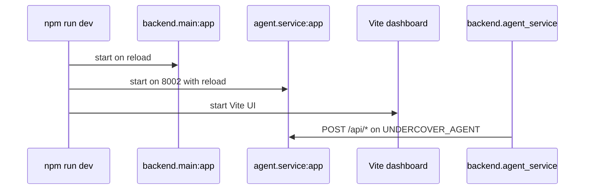
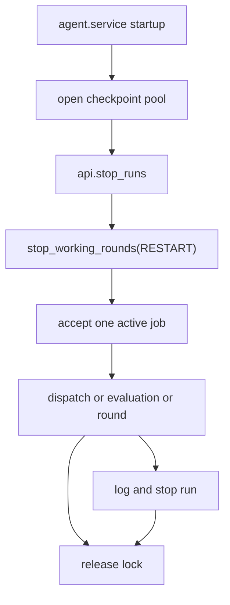

# Runtime and Deployment

This page covers the two runtime pieces that matter for day-to-day operations in this repository:

- the FastAPI backend in `backend/main.py`, and
- the agent service in `agent/service.py`, which the backend calls through `backend/agent_service.py`.

It focuses on safe startup, restart behavior, and the line between local development and deployment targets. Where the repository only partially exposes production wiring, this page stays at the boundaries that the code and docs actually show.

## Local startup and service ports

The root `package.json` is the supported local entrypoint layer. `npm run dev` starts three processes together:

- `backend.main:app` with reload,
- `agent.service:app` on port `8002` with reload, and
- the dashboard through Vite.

The backend script is `uv run --env-file .env -m uvicorn backend.main:app --reload --reload-dir backend`, so local backend runs read the root `.env`. The agent script is `uv run --env-file .env -m uvicorn agent.service:app --port 8002 --reload --reload-dir agent`, so the agent service also reads `.env` and listens on `127.0.0.1:8002` in development.

The repository’s own docs describe the dashboard as part of the same `npm run dev` workflow, and the course materials place the browser UI on the default Vite port while the Python services run beside it.

The local process tree shows the dependency split clearly: the backend owns claim and policy operations, while `backend/agent_service.py` is only the client wrapper used when the backend needs the agent service to continue work after a sign-off or to start a dispatch, evaluation, or round.

## How the backend talks to the agent service

`backend/agent_service.py` uses an `httpx.Client` with a base URL from `UNDERCOVER_AGENT`, defaulting to `http://127.0.0.1:8002`. If the service cannot be reached, the backend translates that into a `503 Service Unavailable` with the message that the agent service is not running. If the agent service answers `409 Conflict`, the backend passes through the detail text unchanged.

That wrapper is used in four places:

- `resume_claim()` after a handler signs off a held payout,
- `start_dispatch()` for dispatch runs,
- `start_evaluation()` for evaluation runs, and
- `start_round()` / `decide_proposal()` for the improvement round workflow.

Because the call is backgrounded after the backend has already committed its own database updates, the sign-off still stands if the agent service is down. The backend logs a warning when the resume call fails, rather than rolling back the decision.

## Agent service lifecycle and restart behavior

The agent service is a FastAPI app with a lifecycle hook that opens the checkpoint pool and resets anything left running by a previous process. On startup it calls `api.stop_runs()` and `stop_working_rounds(RESTART)`, which means a fresh service process treats previously active work as stopped before it accepts new work.

That startup behavior is deliberate operational protection: it keeps stale in-memory concurrency state from surviving a crash or a manual restart.

The service also enforces a single active unit of work with `OneThing`:

- one dispatch,
- one evaluation, or
- one stretch of round work.

If a second job arrives while one is already active, the service returns `409 Conflict` naming what is already running. Dispatches and evaluations run in background tasks after the service has accepted them; rounds do the same. If a background job raises unexpectedly, the service logs the failure, marks the run stopped, and releases the lock so the next job can start.

The service also exposes `/api/health`, which returns `{"status":"ok"}` when the process is up.

## Database seeding and startup invariants

The backend seeds itself on startup only when the database is not already seeded. Its lifespan handler calls `is_seeded(engine())`, and if the check is false it runs `seed(engine())` before serving requests.

That matters operationally because the backend is not just a stateless API shell:

- the seeded data defines the initial claims, policies, customers, handlers, and settings,
- the seed step also creates the schema and tables, and
- the claim queue and evaluation data depend on that initial state.

The separate `npm run seed` command exists for explicit reseeding. It is the supported way to rebuild the database from `data/` when you want a clean local state before running the app or tests.

## Production deployment boundaries

The repository exposes two different production directions, but not the same level of detail for both:

- the course’s main production path is AWS, where Week 3 places the app and the agent into the AWS deployment stack, and
- the free route uses Render instead of AWS.

The root README makes that split explicit, and the lab materials for Week 3 describe the production build as moving the system onto AWS while the free labs substitute Render. The repository does **not** fully contain every deployed target artifact on this page, so the safe operational statement is that deployment wiring is split across the course labs and the platform-specific folders, not centralized here.

For the agent specifically, the current code shows a local FastAPI service today and a cloud service boundary tomorrow. The docs say the cloud version should behave like the local service, but the exact runtime container or orchestration details depend on the deployment track:

- AWS AgentCore Runtime for the main course path,
- Render for the free path.

The AgentCore deployment notes in `labs/undercoverlab/agentcore/cdk/README.md` show that the AWS side is managed by the AgentCore CLI and CDK app, but they intentionally stop short of describing every runtime detail inside this wiki page.

## Operational dependencies that affect behavior

A few dependencies affect whether the system behaves safely when you run or debug it:

- `backend/agent_service.py` depends on the agent service being reachable at `UNDERCOVER_AGENT`.
- `agent/service.py` depends on the checkpoint pool and on its startup reset logic to recover cleanly after restarts.
- `backend/main.py` depends on seeded data for the claims workflow to make sense.
- `npm run dev` expects the root `.env` file to exist and be readable by `uv`.
- Week 3 spend monitoring is separate from the app runtime: `uv run monitor.py` is the helper for AWS cost visibility, not a service the backend calls.

If the agent service is stopped while a dispatch is running, the combined `npm run dev` workflow will stop the other processes too; starting it again brings the services back in a clean state, but the in-flight job is treated as stopped rather than resumed implicitly.

That is the safest mental model for debugging:

1. seed first if the database state is uncertain,
2. start the three local processes together,
3. verify `backend.main:app` on the backend port and `agent.service:app` on `8002`,
4. check the backend health endpoint and the agent health endpoint, and
5. expect restart behavior to stop in-flight agent work before accepting a new job.

The important invariant is that the backend can continue to serve the app even when the agent service is temporarily unavailable, but work that requires the agent will not proceed until the service comes back.
