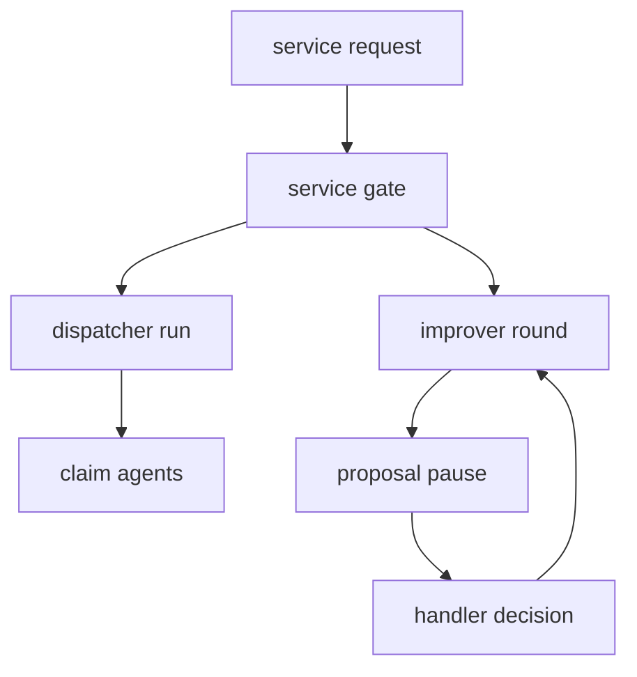

# Agent Tests

The agent test suite is less about unit-level implementation trivia than about the runtime contract of the whole agent service. It verifies how the service, dispatcher, harness, and improver divide responsibility, and it locks in the behaviors that are easiest to break when orchestration changes: one-at-a-time gating, bounded parallelism, retries, restart recovery, and the exact handling of proposals and refusals.

The tests in [`agent/tests/test_command_line.py`](../../agent/tests/test_command_line.py), [`agent/tests/test_dispatcher.py`](../../agent/tests/test_improver.py), and [`agent/tests/test_service_rounds.py`](../../agent/tests/test_service_rounds.py) complement each other:

- `test_command_line.py` checks the command-line and build-time wiring for checkpoint pools, model selection, and claim-agent construction.
- `test_dispatcher.py` exercises the run graph that fans claim work out across agents and decides how failures are retried or reported.
- `test_improver.py` covers the improver graph, proposal approval and rejection, evaluation handling, and the difference between a proposal being recorded and a change actually taking effect.
- `test_service_rounds.py` verifies the HTTP service boundary: request validation, top-level concurrency gating, restart cleanup, and serialization between dispatches, evaluations, and rounds.

## What these tests lock in

The test suite defines the service's runtime guarantees from several angles:

1. **Concurrency is bounded at the right layer.** The dispatcher test suite proves that no more than the configured number of claim agents run at once, while the service-round tests prove the HTTP service only allows one dispatch, evaluation, or improvement stretch to run at a time.
2. **Retries stay local to transient failures.** Dispatcher tests ensure rate limits and timeouts get retried without aborting the whole run, but that the run still completes and leaves later recovery to a future dispatch when retries are exhausted.
3. **Restart and interruption are resumable, not destructive.** The restart tests show that a claim can stop after tool work, after a decision write, after a payment write, or between a write and its checkpoint, and still be carried on without repeating completed work.
4. **Proposal handling is explicit.** Improver tests ensure a proposed version or recipe does not take effect until a handler approves it, that rejections are fed back into the improver as tool output, and that refusals from the backend are surfaced instead of being hidden.
5. **Service refusal paths remain visible.** Both dispatcher and improver tests check that backend refusals, already-started claims, and impossible resumption states are reported as operational failures instead of silent success.

This shows the boundary the tests enforce: the service gates top-level work, the dispatcher fans out claims, and the improver pauses for human decisions.

## Command-line and harness wiring

`test_command_line.py` starts at the outermost entrypoint and checks the non-obvious wiring that makes the rest of the runtime possible.

It verifies that `checkpoint_pool()` opens `DATABASE_URL` with the expected pool settings, configures the `undercover` schema, and initializes a dedicated `PostgresSaver`. It also confirms that each version-specific claim-agent factory gets its own saver instance, which matters because claim graphs should not share mutable checkpoint state accidentally.

That same file checks the CLI's failure behavior too: the command line requires a `claim_id`, and when `work_claim()` refuses to start a claim, `main()` exits with a non-zero code after printing the refusal. It also verifies version-sensitive model construction, including model-name overrides and reasoning-effort behavior.

These are not decorative tests. They pin down the boundary between the CLI, the harness, and the backend-backed graph builders, so changing a connection or graph factory does not silently change runtime ownership.

## Dispatcher tests: fan-out, ordering, and retries

`test_dispatcher.py` defines the dispatcher as a graph that selects work, fans it out, and finishes the run. The graph shape itself is asserted, which means the nodes and edges are part of the contract, not an implementation detail.

The important runtime cases are the ones that would otherwise be easy to get wrong:

- the configured `RETRY` policy is zero-wait in tests and allows three attempts for transient failures;
- the dispatcher never runs more claim agents concurrently than the run allows;
- dispatch ordering favors older waiting claims and includes in-progress work when appropriate;
- claims already resumed elsewhere are reported rather than re-started blindly;
- transient model failures do not fail the whole dispatch, and non-transient failures are converted into per-claim reports so the run can still complete;
- a dispatch interrupted mid-run is finished correctly on the next invocation, reusing saved claim state rather than starting over.

One especially important boundary is that the dispatcher is not responsible for sign-off semantics or proposal approval. It orchestrates claim work and reports outcomes; the harness and service own the pause/resume logic and the backend state that makes those resumes safe.

## Improver tests: proposal lifecycle and evaluation discipline

`test_improver.py` focuses on the model-driven improvement loop. Those tests show that the improver is not just another dispatch: it is a graph that reads results, proposes a change, waits for human approval, and may then run evaluations of a candidate version before deciding whether to keep or roll back the change.

The suite locks in several subtle behaviors:

- the improver uses the expected model configuration and tool set;
- model calls are serialized one at a time rather than allowing parallel tool use;
- a proposal remains inert until the handler records approval;
- rejection reasons are fed back into the model as tool messages so the improver can respond to the human's objection;
- invalid proposals, such as a model not allowed for the round, are returned to the improver instead of being accepted;
- evaluation refusal because of budget or other service constraints rolls the version back instead of leaving the round in an ambiguous state;
- a round stopped mid-evaluation does not continue silently after restart or resume, and already-recorded evaluation state stays coherent;
- a second proposal or second evaluation for the same tried version is rejected back into the improver rather than creating a duplicate version trail.

This file is also where the line between service and improver stays clear: the service records the human decision first, then resumes the improver; the improver itself decides how to continue after receiving the decision.

## Service-round tests: HTTP boundaries and serialization

`test_service_rounds.py` is the clearest source for the service's request-level guarantees. It checks that the FastAPI app accepts and rejects the right requests, but more importantly it verifies the timing relationship between the service lock, the dispatcher, and the improver.

The suite proves that:

- starting a round waits for a handler decision and records that the round is waiting for change;
- a decision is persisted with its handler before the improver is resumed;
- a decision attempt made while a dispatch is running is refused and does not mutate the round;
- a dispatch and an evaluation can run while a round is waiting, but only through the serialized top-level work path;
- the one-thing-at-a-time gate refuses competing requests with HTTP 409;
- a failing round is stopped with the failure reason attached;
- service startup marks leftover rounds from a previous process as stopped, which keeps stale work from surviving a restart.

These tests define the outermost safety boundary. Even if the dispatcher and improver are both healthy, the service must still prevent overlapping top-level work and must recover cleanly when a process restarts.

## Practical reading of the suite

If you are changing the runtime, the tests tell you where to look first:

- changing claim scheduling or retry rules means updating dispatcher tests and the graph wiring they assert;
- changing resumability or checkpoint behavior means checking restart tests and the carry-on paths used by the harness;
- changing proposal flow means checking improver tests and service-round tests together, because one covers the graph semantics and the other covers the HTTP orchestration around them;
- changing service concurrency rules means checking `test_service_rounds.py` first, then the dispatcher and improver suites to make sure the lock still protects the right boundaries.

Together, these tests define the difference between a claim agent that merely runs and an agent service that can be stopped, resumed, retried, and restarted without losing the shape of work.
