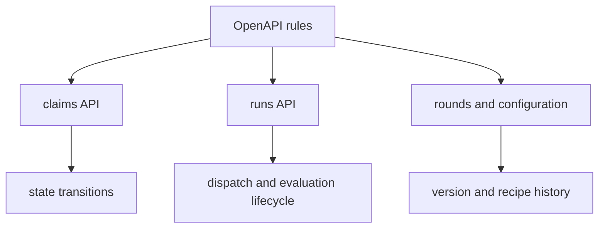
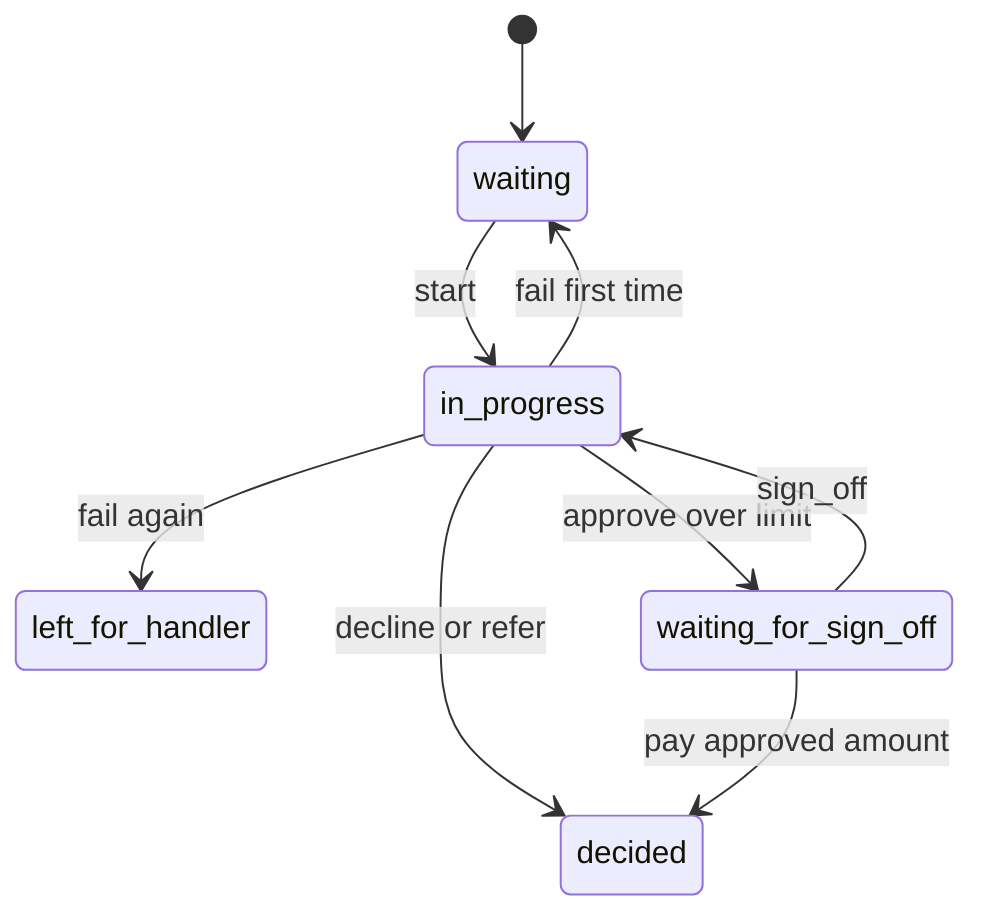
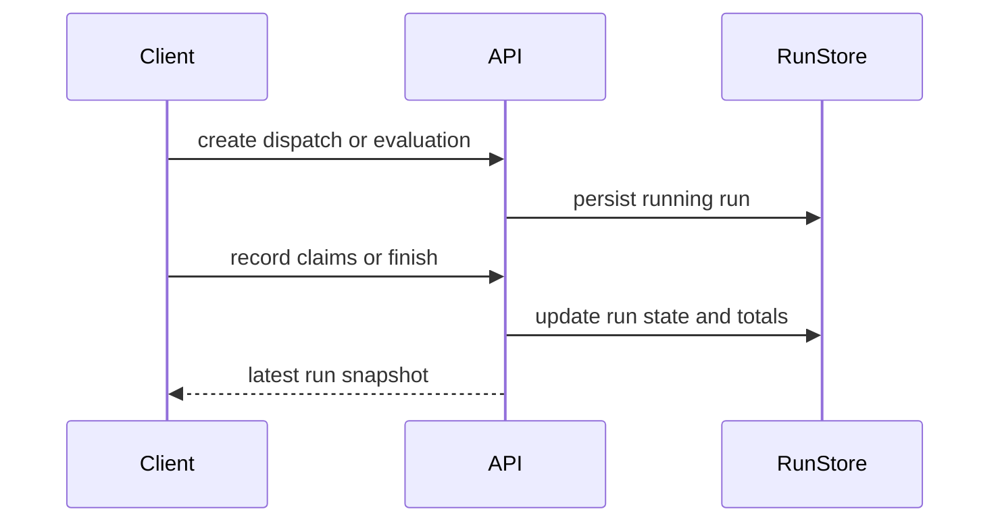

# Backend Tests

The backend test suite is the executable specification for the service boundary. It does not just check that endpoints return JSON; it fixes the shape of the API, the allowed state transitions, the persistence rules behind those transitions, and the failure modes that callers depend on.

The coverage is organized by behavior rather than by file name:

- **Public API shape and documentation**: OpenAPI output must satisfy the repository's API rules, including response and schema constraints.
- **Claims and workflow state**: claim lookup, work start, step recording, decisions, payments, and sign-off all have explicit transition rules.
- **Dispatch and evaluation runs**: run creation, ordering, serialization, summary totals, and restart behavior are pinned down.
- **Rounds and configuration history**: rounds bind to a specific configuration version and recipe snapshot, and version history preserves diffs, scores, and current-version selection.
- **Operational boundaries**: invalid identifiers, repeated actions, concurrent work, over-limit payouts, and restart cleanup are all tested as failure cases, not left to inference.

This diagram summarizes the main test targets: the OpenAPI contract constrains the surface, and the runtime suites pin down the stateful behaviors behind that surface.

## Public API shape and schema rules

`backend/tests/test_openapi.py` establishes that the generated OpenAPI document must comply with the repository's API rules. The suite checks the whole document from `GET /openapi.json`, so changes to operation metadata, request bodies, or response schemas that violate the rules are caught as contract failures rather than as ad hoc breakage.

It also documents a boundary that the code relies on: optional fields inside nested request bodies are not allowed in at least one case. The test that builds a small `FastAPI` app with a nested body model and an optional inner field proves that `rule_breaks()` reports the violation as `POST /things: Inner.size is optional`. That makes the rule concrete for schema authors: optionality inside a body model can be a rejected shape, not just a style preference.

## Claim and workflow state transitions

The claim tests define the core lifecycle of an individual claim. They show that the queue starts with 25 waiting claims ordered by `claim_id`, that a claim detail response includes the customer, story, documents, and current decision state, and that unknown claim, policy, and customer identifiers all return `404` with a not-found message.

The workflow tests then pin down the mutable states:

- starting a claim moves it to `in_progress` and assigns a thread id;
- the first start increments the attempt counter;
- step records are only accepted while a claim is in progress, and they preserve ordering and timestamps;
- only known step kinds are accepted;
- decisions require a claim in progress, and invalid decision payloads are rejected with `422` without mutating stored state;
- repeated identical decisions or payments are idempotent, but different repeated values are rejected with `409`;
- a claim approved within the limit can be paid immediately, while an over-limit approval moves to `waiting_for_sign_off` until a handler approves it;
- decline and refer decisions end the claim without payment.

This lifecycle is the main contract the tests protect. The important boundary is not the exact SQL write, but the sequence of allowed states and the refusal of invalid transitions.

The workflow tests also capture sign-off behavior as a persistence boundary. A sign-off is recorded before the backend tries to resume the agent, the saved sign-off survives even if the agent cannot be reached, and the backend refuses sign-off attempts from handlers who are not allowed to approve the payout.

## Failure handling and recovery

Failure behavior is not incidental in this suite; it is part of the contract.

The failure tests show that a first model failure returns the claim to the queue, while a second failure leaves it for a handler, preserving the error history on the claim steps. They also document the negative cases: failure cannot be recorded before a claim is in progress, after a decision has already been made, or for an unknown claim, and an empty failure reason is rejected.

The workflow tests add complementary failure boundaries around sign-off and payment: a claim copy inside an evaluation cannot be signed off, a payout that does not match the approved amount is rejected with `422`, and a payout over the limit requires sign-off before it can be recorded. Those tests keep the service from silently accepting a state change that would violate downstream assumptions.

## Dispatch lifecycle and run summaries

The run tests define the dispatch lifecycle. A dispatch starts in `running`, has a bounded number of agents, records its version, and is indexed as the latest dispatch when it is the newest run. The suite also enforces that a run cannot be created with fewer than 1 or more than 25 claim agents.

When claims are recorded against a dispatch, the backend preserves their order, requires the run to exist and still be running, and rejects unknown claim ids. As claim work progresses, the run view exposes per-claim state, accumulated model cost, and elapsed seconds. Finishing a dispatch computes the summary totals for approved, declined, referred, waiting-for-sign-off, left-for-handler, and unfinished claims, and the run cannot be finished twice.

The same suite also covers the top-level run boundary: `POST /api/runs/stop` stops every running run and returns the run ids it stopped, while already finished runs remain finished. A separate ordering test shows that runs started in the same second still preserve deterministic numbering and latest-run selection.

This flow captures the persistence boundary the tests protect: run creation, claim recording, and run completion are separate steps, and the API must keep the latest run snapshot consistent across them.

## Evaluation runs and copied claims

Evaluation tests establish that an evaluation run works on copied claims, not the originals. The copied claims are suffixed by evaluation number, preserve ordering, and expose a `copy_of` link back to the original claim. Creating an evaluation does not alter the ordinary claim queue, and copied claims cannot be signed off.

These tests also pin down evaluation scoring. Before any work is done, the evaluation reports baseline measures such as decision accuracy, accuracy, cost of mistakes, straight-through rate, model cost per claim, seconds per claim, and judge cost. After work is completed, the evaluation result reflects the decisions made on the copies, including whether a handler decision was required and what mistake cost was assigned.

A useful boundary is that evaluations are isolated from the dispatch API: an evaluation run's claims cannot be recorded as a dispatch, and the evaluation list is ordered newest-first. That separation lets the backend keep dispatch summaries and evaluation metrics distinct.

## Configuration history, diffs, and current version selection

The configuration tests document how versions become current. Version 1 is the baseline claim-agent configuration, its agent view omits score data, and the current version is always the newest version whose verdict is `kept`. Versions with `rolled_back` verdicts remain in history without becoming current.

The suite also shows that version history is not just a list of blobs. A version exposes the diff relative to the version it was based on, including unchanged, added, and removed instruction lines, and its scores are available for both `evaluation` and `held_out` sets when present. The older version keeps an empty diff, while missing versions return `404`.

One boundary the tests preserve is that the historical instructions endpoint is gone. That protects callers from depending on a deprecated route and forces them to use the versioned configuration view instead.

## What the suite protects for future changes

If you change backend behavior, these tests tell you what is safe to alter and what is part of the contract:

- API schema changes must still pass the OpenAPI rules.
- Claim transitions must preserve the same state machine, idempotency rules, and sign-off restrictions.
- Run creation, completion, and stop behavior must keep their ordering and summary semantics.
- Evaluation runs must continue to isolate copied claims from the dispatch path.
- Configuration changes must keep version history, diffs, and current-version selection coherent.

In other words, the backend tests define the service's public surface and its stateful invariants together. They are the guardrails that keep API consumers, persistence code, and orchestration code aligned.
