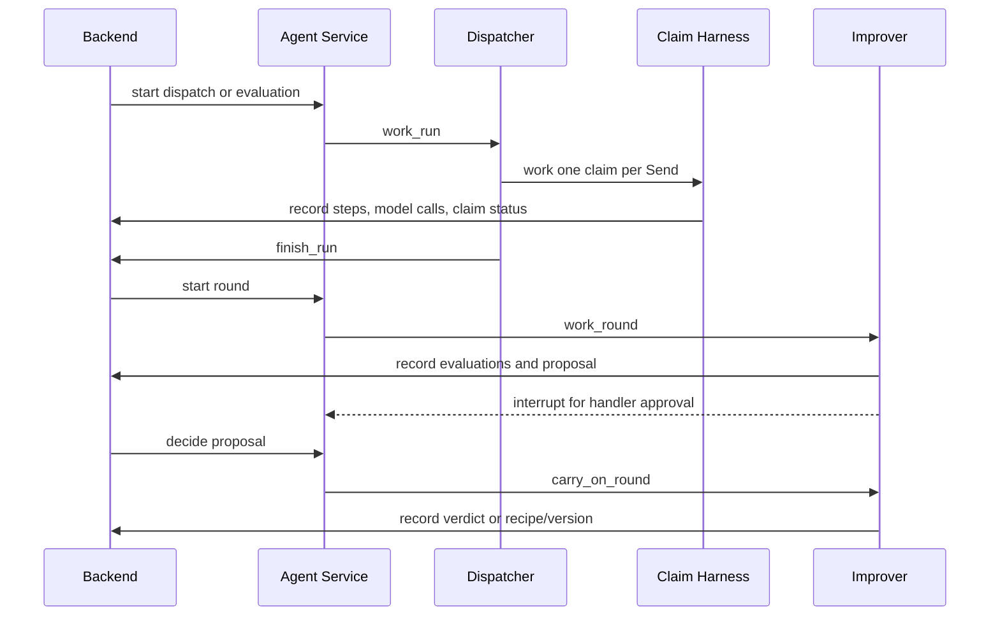
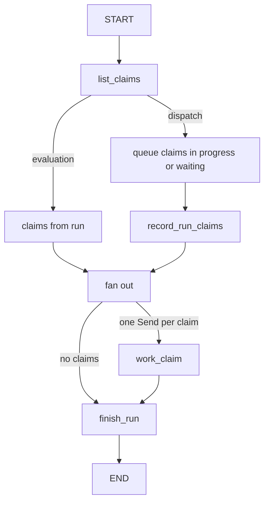
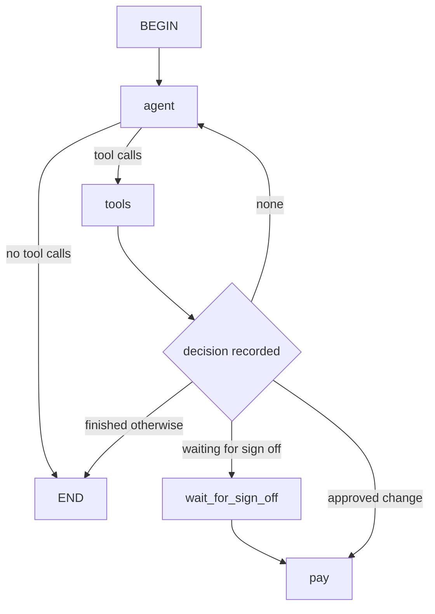

# Agent Dispatch and Improvement Workflow

This page traces the agent runtime's two connected execution paths:

1. **Dispatch and evaluation processing**: the service starts a run, fans work out across claim agents, records each claim's result, and reports back to the backend when the run ends.
2. **Handler-reviewed improvement rounds**: the service runs the improver, pauses for a handler's approval or rejection, resumes after that decision, and applies the round's verdict to the backend.

Both paths use LangGraph checkpoints and backend APIs, but they differ in what they serialize, how they resume, and when the backend is allowed to change state.

## Big picture

The service sits between the backend and the claim or improver graphs. The backend creates and owns the durable records for runs, rounds, proposals, versions, and decisions. The service performs the runtime work and then calls back into backend-facing APIs to persist the outcomes.

The diagram shows the main control loop: dispatches and evaluations are backend-started runs, while improvement rounds are backend-started rounds that may pause for human review and then resume.

## Dispatch and evaluation path

### Entry points and run creation

The backend invokes the agent service through `backend/agent_service.py`. It translates backend requests into service calls for:

- `start_dispatch(agents)`
- `start_evaluation(evaluation_set, tiny, agents)`
- `resume_claim(claim_id)`

The service exposes those operations on `/api/dispatches`, `/api/evaluations`, and `/api/claims/{claim_id}/resume`, and it answers `202 Accepted` when it accepts the work.

The service treats dispatches and evaluations as mutually exclusive top-level jobs. `OneThing` enforces that only one dispatch, evaluation, or round can run at a time. If another job is already running, the service returns `409 Conflict` naming the active work.

### How the dispatcher selects work

`agent/dispatcher.py` builds a small LangGraph with three nodes: `list_claims`, `work_claim`, and `finish_run`.

- For an **evaluation**, `list_claims` uses the claim copies already recorded on the run.
- For a **dispatch**, it reads the backend's claim queue, sorts by submission time and claim id, keeps only claims in `IN_PROGRESS` or `WAITING`, and excludes claims the service is resuming after sign-off.
- For a dispatch, it also records the selected claim ids back to the backend with `record_run_claims`.

The dispatcher uses `max_concurrency = run["agents"]`, so at most that many claim agents run at once for the run. The tests verify that the dispatcher never exceeds the requested parallelism.

### Claim harness behavior

`agent/harness.py` builds and runs the claim agent graph. Each claim graph:

- persists progress through `PostgresSaver` in the `undercover` schema,
- saves after every step,
- records model calls, tool calls, tool results, and artifacts back to the backend,
- caps model calls per claim at `CLAIM_MODEL_CALLS`,
- keeps tool execution to one call at a time for a claim thread.

The harness distinguishes three claim work modes:

- `work_claim`: start a fresh attempt on a new claim thread,
- `carry_on`: resume an existing in-progress claim from saved state,
- `work_in_run`: choose between the two based on backend claim status, then finish a held evaluation copy.

`carry_on` is the key restart-aware path. If the saved state shows the claim is paused for sign-off, it resumes from the interrupt; if nothing is saved yet, it starts the claim on its own thread; otherwise it continues from the last checkpoint. This is what lets a restarted service continue in-flight work without redoing already-saved steps.

### Retry and failure handling

The dispatcher wraps `work_claim` in a LangGraph `RetryPolicy` for transient model failures such as rate limits and timeouts. It retries up to three attempts with backoff, and the claim continues from the last saved step because the claim graph is checkpointed.

If the claim agent still fails after its retries, the dispatcher does not fail the whole run. It records a report line saying the claim was left for the next dispatch or left in progress, depending on whether the run was a dispatch or an evaluation.

If a non-transient exception happens inside the claim work, the harness converts it into a claim-level failure report unless the error occurred after the claim had already reached a stable decision. This is why one failed claim does not stop the other claim agents in the same run.

### Sign-off pause and resume

Approved claims can pause at `wait_for_sign_off`. The claim graph interrupts there, and the backend records the claim as waiting for sign-off. The service later resumes that claim through `/api/claims/{claim_id}/resume`.

The service protects resumed claims from being picked up by another dispatch while they are being continued. It adds the claim id to the `resuming` set before scheduling the background resume task, and the dispatcher excludes those ids when it selects queue work.

The resumed claim is continued on the same thread and checkpoint history. After the graph finishes, the harness clears the checkpoint thread for an evaluation copy that was only held for sign-off, because nobody can sign off that copy later.

## Improvement round path

### Round startup and serialization

The backend starts a round through `backend/rounds.py`, which checks that no other round is open and then calls the agent service's `/api/rounds` endpoint. The service again uses `OneThing`, so only one round can be active at a time.

The service schedules round work as a FastAPI background task. The initial stretch of a round is run asynchronously, so the HTTP request can return immediately while the round continues in the background.

`work_in_background` is the common runner for dispatches, evaluations, and rounds. It creates the backend run or round record first, names the running unit in `one_thing`, executes the work, and always releases the lock in a `finally` block. If an unexpected exception escapes, the service stops the backend runs so the system does not keep advertising a live job that has actually failed.

### The improver graph

`agent/improver.py` builds a LangChain agent with:

- the improver model configuration,
- a fixed tool set: `read_results`, `propose_change`, `run_evaluation`, and `propose_recipe`,
- middleware that caps calls, enforces sequential tool usage, records model cost, converts backend refusals into tool answers, and requires human approval for proposals.

The improver saves its own progress with a checkpoint saver so that a round waiting for a handler can survive a restart.

The graph is intentionally restart-safe: `stop_with_the_round` checks the round stage before each model call, so once a round is closed or stopped, the improver stops making further model calls.

### Proposal approval and backend writebacks

The improver can create two kinds of proposals:

- **Change proposals** that alter instructions, model, or reasoning effort.
- **Recipe proposals** that update the recipe text itself.

The approval middleware only pauses for a handler on change proposals that use an allowed model and reasoning effort, and only if the round has not already tried a version. Recipe proposals are also gated by handler approval before they are saved.

When the backend records a handler decision, the service resumes the improver with `carry_on_round(round_id, proposal, decision, improvement)`. The resume payload is different for approval and rejection, and rejection reasons are passed back into the improver so the agent can react to them.

The backend applies the round's final state based on the same rule the improver used during the round:

- If a tried version's evaluations were stopped, the round rolls it back.
- If the round could not afford all required evaluations, it rolls the version back.
- Otherwise the verdict is based on the measured scores and objectives.
- If the round ends before verdict, the backend rolls back the tried version and closes waiting proposals.

This means the improver does not directly mutate the canonical version state; it proposes and evaluates, and the backend decides whether the version is kept or rolled back.

## Concurrency, background tasks, and serialization boundaries

There are three serialization layers to keep in mind:

1. **Top-level job serialization** in the service with `OneThing`.
2. **Per-run parallelism** in the dispatcher with `max_concurrency = run["agents"]`.
3. **Per-claim and per-round checkpoint serialization** through LangGraph checkpoint savers.

The service serializes whole jobs because dispatches, evaluations, and rounds share backend state and should not overlap.

The dispatcher serializes each claim graph by thread id, but allows multiple claims in the same run to progress concurrently up to the configured limit.

The improver serializes its own thread and uses `parallel_tool_calls = False`, so a single model reply cannot try to create two proposals at once. That prevents races between competing proposal writes.

## Restarts and in-flight work

Restarts matter differently for each path:

- **Dispatch/evaluation restarts**: the service starts by stopping any run left marked as running by the previous service process. In-flight claim work can resume from checkpoints, and resumed claims are excluded from the next dispatch selection until they are continued.
- **Round restarts**: the service stops any round that was left open by an earlier service process. The improver can resume from its checkpointed state when a handler decision arrives later.
- **Backend restarts or stale state**: the backend remains the source of truth for round stage, proposal status, verdict, and version history. The service only continues work if the backend state still permits it.

This combination keeps the service restart-tolerant without allowing duplicated backend writes.

## What the tests protect

The focused tests exercise the behavior that matters most for safe changes:

- `agent/tests/test_dispatcher.py`
  - the dispatcher graph shape and retry policy,
  - concurrency limits for claim agents,
  - selection order for queue claims,
  - transient retry behavior and the left-over report on repeated failure,
  - resuming after sign-off and preserving in-flight state.
- `agent/tests/test_improver.py`
  - the improver model, middleware, and one-tool-call-at-a-time rule,
  - first-evaluation progress and proposal pause behavior,
  - version trial, recipe proposal, and verdict recording,
  - refusal handling and restart-safe resumption,
  - round stopping and model-call capping.
- `backend/tests/test_rounds.py`
  - round creation and stage transitions,
  - backend checks for allowed models, affordability, and required evaluations,
  - verdict behavior when evaluations stop or a round is stopped,
  - proposal decision routing through the service.

Together, these tests define the main invariants for the workflow: serialized top-level work, bounded parallelism within a run, checkpointed resumption, and backend-owned decisions for version and round state.
