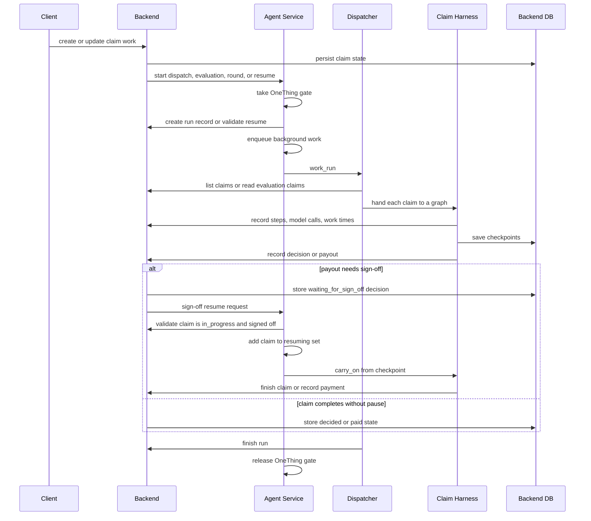

# Request Lifecycle

This page traces the life of a claim request across the backend, agent service, and persistence layer. It focuses on the checkpoints that matter when changing behavior: who owns each transition, where retries happen, how sign-off pauses are resumed, and how failures are surfaced without losing backend state.

The end-to-end shape is:

1. the backend owns the canonical claim state and queue;
2. the agent service picks up eligible claims or resumes a paused claim;
3. the dispatcher and claim harness work the claim one step at a time with checkpoints;
4. the backend records decisions, payouts, payments, and sign-off state;
5. and the agent service resumes work after sign-off when the backend allows it.

## Ownership boundaries

The backend owns durable claim transitions and validation. It decides whether a claim may move from `waiting` to `in_progress`, whether a decision is legal, whether payout and payment agree, and whether a sign-off transition reopens the claim for more agent work. The agent service does not mutate those states directly; it orchestrates runs and claim resumes by calling backend APIs.

The agent service owns runtime scheduling. It serializes top-level work with `OneThing`, creates backend run records, starts background tasks, and resumes claims after sign-off. The dispatcher and harness own the in-memory and checkpointed execution of claim work, but they rely on backend status checks before and after work.

The persistence layer is split accordingly:

- backend SQLAlchemy tables hold claims, decisions, payments, runs, and related state;
- the agent service uses a shared checkpoint pool for LangGraph progress;
- and the claim harness stores graph checkpoints so a later dispatch or resume can continue from the last saved step.

## End-to-end sequence

This diagram shows the runtime contract: the backend decides legality, the agent service schedules and resumes, the dispatcher fans out work, and the harness persists progress between steps.

## Backend queue to agent pickup

The lifecycle begins when claims are already in the backend queue. The dispatcher does not invent work items; it asks the backend for claims and then filters them.

For a dispatch, the dispatcher:

- reads the backend queue with `api.list_claims()`;
- sorts by submission time and claim id;
- keeps only claims whose status is `waiting` or `in_progress`;
- excludes claims currently marked as resuming;
- and records the selected claim ids back to the backend with `record_run_claims`.

For an evaluation, the dispatcher does not read the queue. It uses the run's preselected claim copies instead, which keeps evaluation work anchored to the backend-created run record.

The minimum checkpoint before changing dispatcher behavior is to verify that queue selection still respects ordering, status filtering, and the resuming exclusion. The focused tests in `agent/tests/test_dispatcher.py` cover those rules.

## Top-level scheduling and gating

The agent service receives the request first for runtime work: `/api/dispatches`, `/api/evaluations`, `/api/rounds`, and `/api/claims/{claim_id}/resume`.

Before it starts background work, the service checks three things:

- `OneThing.take()` succeeds, so no other dispatch, evaluation, or round is already active;
- the backend accepts the new run or resume request;
- and the request is valid enough to schedule work without blocking the HTTP response.

If another top-level job is already running, the service returns HTTP 409 and names the work in progress. That behavior is important because dispatches, evaluations, and rounds share the same backend state and must not overlap.

The service also releases the gate in a `finally` block, even after failure. That keeps later work from being stranded behind a failed background task.

## Dispatch execution path

A dispatch run is the main queue-processing path. The service creates the backend run record, names the active work, and then hands the run to `work_run()` in the background.

The dispatcher then:

- builds the list of claims for the run;
- fans them out with one `Send` per claim;
- uses `max_concurrency = run["agents"]` so only the configured number of claim agents run at once;
- and calls `api.finish_run()` after every claim returns.

Each claim work item is handled by the claim harness. The harness builds a checkpointed claim graph, records model calls and tool results to the backend, and saves progress after each step. That checkpointing is what lets a later retry or restart continue from the last saved state instead of replaying the whole claim.

### Failure handling in dispatches

Dispatches are intentionally resilient to claim-level failure. A single claim failure does not fail the whole run.

Transient model failures, such as rate limits and timeouts, are retried up to three attempts with backoff. If the claim still fails after the retry budget, the dispatcher records a report line and leaves the claim in progress for a later dispatch or resume. Other exceptions are also converted into a report line so the run can continue with the remaining claims.

The important checkpoint before changing retry behavior is to preserve the distinction between transient claim retries and non-transient report-only failures. If that boundary changes, the dispatcher could either stop too early or retry forever.

## Sign-off pause and resume

A claim may pause when payout approval requires human sign-off. The claim graph interrupts at `wait_for_sign_off`, and the backend records the claim as `waiting_for_sign_off` with sign-off metadata on the decision row.

At that point the backend still owns the state transition. The agent service only resumes the claim after the backend says it may be resumed.

The resume path is:

1. the caller invokes `/api/claims/{claim_id}/resume`;
2. the service loads the claim from the backend;
3. it verifies the claim is `in_progress` and already has `signed_off_by` recorded;
4. it adds the claim id to the `resuming` set;
5. and it schedules a background `carry_on()` call.

The dispatcher excludes ids in `resuming`, which prevents a resumed claim from being picked up by a fresh dispatch while the carry-forward work is still running. When the resume work finishes, the service removes the claim from `resuming` in a `finally` block.

The minimum checkpoint before changing resume behavior is to verify both sides of the exclusion: the service must add the id before background work starts, and the dispatcher must keep excluding it until the resume path ends.

## Decision, payout, and payment

Decision and payment are separate backend-owned transitions.

The claim harness eventually reaches the `pay` node for approved claims. That node calls the backend payout endpoint with the approved payout from the decision. The backend computes payout independently using policy and claim data, and it returns whether the payout needs sign-off.

If the payout exceeds the approval limit, the backend keeps the claim in `waiting_for_sign_off` and records sign-off metadata instead of paying immediately. After sign-off, the resume path allows the agent service to continue the claim and the backend can record the final payment.

If the claim is approved and the payout is within the limit, the backend records the payment and the claim reaches its decided end state. If the claim is declined or referred, the run still completes, but there is no payment step.

The minimum checkpoint before changing payout behavior is to preserve the backend as the source of truth for the computed payout and the payment write. The agent should not infer payment state on its own.

## Failure handling, retries, and restarts

The flow has several explicit failure boundaries:

- top-level contention returns HTTP 409 from the agent service;
- backend refusal responses are propagated back to callers as structured errors;
- dispatch retries only cover transient model problems;
- unexpected run failure causes the agent service to stop runs so the backend does not keep advertising live work;
- and service startup stops leftover runs and working rounds from a previous process.

Restart behavior matters because both the dispatcher and the claim harness checkpoint their progress. On restart, the backend still owns the canonical claim status, while the agent service can resume from the checkpointed claim state if the backend still permits it.

This means the system is restart-tolerant but not restart-agnostic: a saved checkpoint is only useful if the backend state still matches the claimed transition.

## What to verify before changing behavior

Before changing this workflow, check the smallest set of invariants that keep it safe:

- queue selection still honors ordering, status filtering, and the resuming exclusion;
- only one top-level job can run at a time;
- retries still cover transient model failures only;
- sign-off resume still requires backend approval state and still excludes the claim from dispatch selection;
- payout and payment still remain backend-owned transitions;
- and restarts still stop leftover runs before new work starts.

Those are the checkpoints that prevent duplicate work, stale resumes, and backend state drift.

## Focused tests that matter

The most relevant tests for this page are:

- `agent/tests/test_dispatcher.py`
  - queue ordering and filtering;
  - concurrency limits;
  - transient retry behavior;
  - repeated-failure reporting;
  - resumed-claim exclusion.
- `agent/tests/test_service.py`
  - one-at-a-time gating;
  - resume validation;
  - failure stop behavior;
  - restart cleanup.
- `backend/tests/test_runs.py`
  - run creation, finish, stop, and status validation;
  - recorded claim ordering and summary behavior.
- `backend/tests/test_claims.py` and payout-related backend tests
  - claim state transitions;
  - sign-off behavior;
  - payout and payment invariants.

Together these tests define the lifecycle contract: the backend owns valid state transitions, the agent service schedules and resumes work, the dispatcher and harness execute the claim graph, and checkpoints make recovery possible without redoing committed work.
