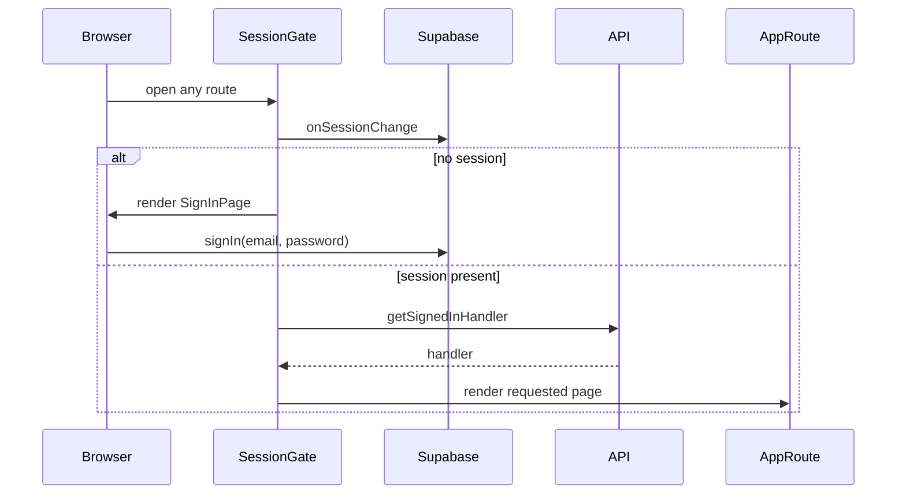
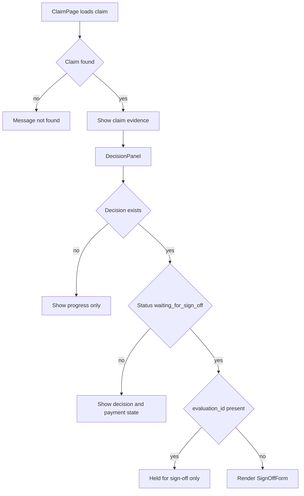
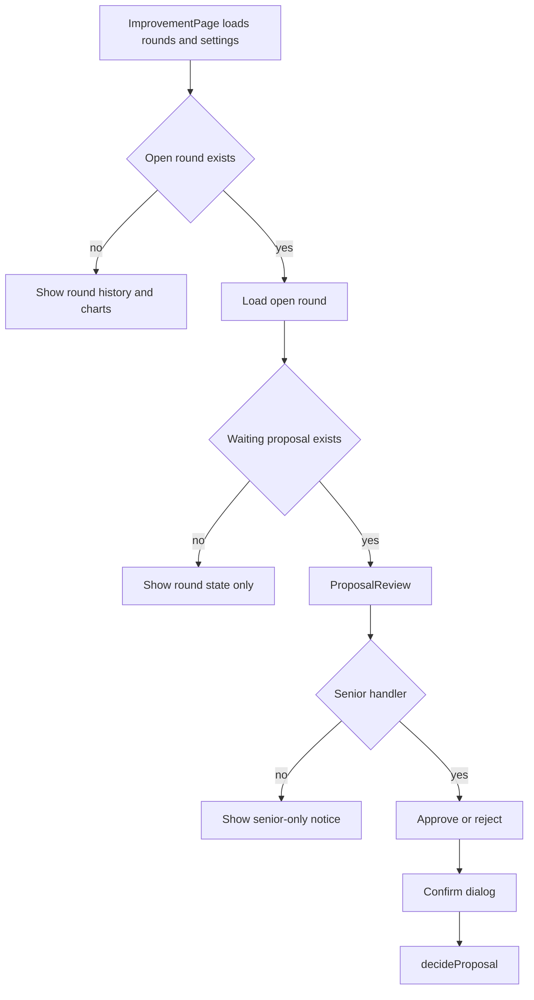

# User and Handler Flows

This page describes the dashboard routes as operational flows: how a person gets into the app, what each page shows, and which API calls and sign-off actions each screen depends on. It is written for safe UI changes, so the emphasis is on route-to-action mapping, data dependencies, and the places where permissions change what can be done.

## Session gate and sign-in

The whole app sits inside `SessionGate`, so every route is protected by the current Supabase session. While the session is still loading, the app shows a neutral message state. If there is no session, `SessionGate` replaces the requested page with `SignInPage`. If a session exists, it looks up the signed-in handler with `api.getSignedInHandler` and only then renders the route tree.

The top header also reflects the active handler and exposes a global sign-out button that calls `signOut()`.

Caption: session-gated route selection from sign-in through handler lookup and route rendering.

## Route map

`App.tsx` defines the main route-to-page mapping:

- `/queue` → `QueuePage`
- `/queue/:claimId` → `ClaimPage`
- `/scoreboard` → `ScoreboardPage`
- `/scoreboard/evaluation/:runId` → `EvaluationPage`
- `/configuration` → `ConfigurationPage`
- `/improvement` → `ImprovementPage`
- `/settings` → `SettingsPage`

The nav bar marks Queue as active not only on the queue list but also on claim detail pages, because claim detail pages are treated as part of the queue workflow.

## Queue flow

`QueuePage` is the main handler workspace. It loads the queue with `api.listClaims` and refreshes on a polling interval via `useLoad(..., REFRESH_MS)`. If the data fails to load, the page shows `Message` instead of an empty dashboard.

The page has three distinct responsibilities:

1. show claim counts by status,
2. let the handler start a new dispatch through `DispatchPanel`, and
3. list every claim with its current state, decision, and payout.

`DispatchPanel` itself depends on `api.getLatestDispatch` for the latest run state and `api.startDispatch(agents)` when the user starts a dispatch. The chosen agent count comes from `AgentsChoice`. The panel can also show the current run, its claims, and a status summary from the backend.

The queue table is a read-only overview built from `listClaims`; each row links into the claim detail page.

## Claim detail flow

`ClaimPage` loads a single claim with `api.getClaim(claimId)` and refreshes it periodically. It resolves the claim id from the URL, and if the claim is missing the page renders `Message` with a not-found message.

The page adapts its breadcrumb trail to the source of the claim:

- if `evaluation_id` is present, the breadcrumb chain is Scoreboard → Evaluation → Claim;
- otherwise it is Queue → Claim.

This matters because evaluation copies are treated as children of a scored run, while normal claims are treated as part of the queue.

The page splits into two columns:

- the left column is the claim evidence view: summary, customer story, items, and documents;
- the right column is the handler action and context column: decision state, step history, policy, and customer claim history.

The action dependency here is `DecisionPanel`. That component uses the claim’s `decision`, `payment`, `status`, `attempts`, and `evaluation_id` to decide whether the claim is merely being processed, is waiting for sign-off, or is an evaluation copy that cannot be signed off.

If the claim has a decision and the status is `waiting_for_sign_off`, `DecisionPanel` renders `SignOffForm` for normal claims. For an evaluation copy, the same state becomes informational only: the UI says the payment is held for sign-off, but no sign-off action is available because evaluation copies cannot be signed off.

The page reloads itself after sign-off through the `onSignedOff={reload}` callback.

Caption: claim detail decision branching, including the sign-off exemption for evaluation copies.

## Dispatch and queue work

The dispatch panel is the queue-side execution flow. It starts a new dispatch with the selected concurrent agent count, then shows the latest run, its claims, and the summary of what happened to them.

The backend data it depends on is the latest dispatch run, which includes:

- the run status,
- the claims handled in that run,
- the summary counts of approved, declined, and referred claims,
- the lists of claims waiting for sign-off, left for a handler, and left unfinished for the next dispatch.

This makes the queue page the operational place where a handler sees whether claims are still in progress, need sign-off, or must be picked up later.

## Evaluation flow

`EvaluationPage` loads a scored run with `api.getEvaluation(runId)`. It is a read-only review page for comparing a handler decision against the agent copy that was judged. If the run is missing, the page shows a not-found message.

The page has two main data sections:

- `MeasuresPanel`, which shows the evaluation set, size, agent concurrency, model, start time, and the summary measures from the run;
- `ScoredClaims`, which lists each copy alongside the handler decision, the agent decision, the right/wrong result, the judge grade, and the cost and time metrics.

A scored claim may have no agent decision yet; in that case the UI shows “No decision”. A claim that the agent did not decide counts as a referral.

The evaluation page depends on the scored claim fields returned by the backend, especially `handler_decision`, `handler_payout`, `decision`, `payout`, `right`, `grade`, `mistake_cost`, and `model_cost`.

## Improvement flow

`ImprovementPage` is the round-management page for proposing, reviewing, and either accepting or rejecting improvements.

It loads two sources in parallel:

- `api.listRounds` for the round list and current open round, refreshed periodically;
- `api.getSettings` for the current operating limits that determine whether a handler may start or stop rounds.

The page uses the signed-in handler’s permission flag `can_approve_over_limit` to decide whether the action buttons should be visible or replaced by a senior-only notice.

### Starting a round

A senior handler can start a round only when there is no open round. The button opens a confirmation dialog, then calls `api.startRound()`. The round may first run the current version’s evaluations, after which the improver proposes a change for review.

### Reviewing a proposal

When there is an open round, the page fetches that round with `api.getRound(roundId)` and renders the waiting proposal through `ProposalReview`. That component is the approval gate for the improvement pipeline.

`ProposalReview` shows:

- what the proposal changes,
- the reason the improver gave,
- the diff for the proposed recipe or instructions,
- and, for a senior handler, approve/reject buttons.

Approval and rejection both go through a confirmation dialog before calling `api.decideProposal(roundId, proposalId, decision, reason)`.

Rejection requires a reason. The reason is included in the confirmation dialog and is sent with the decision. If the signed-in handler is not allowed to approve over the limit, the page shows a senior-only notice instead of the review controls.

### Stopping a round

A senior handler can stop the open round with `api.stopRound(round.round_id)`. The page explains that a round stopped before verdict leaves the current version in place, finishes work already in hand, and starts nothing new.

### What the round page depends on

The improvement workflow depends on the round stage and proposal fields returned by the backend:

- `round.stage` drives whether the page treats the round as open;
- `round.proposals` determines whether the waiting proposal is displayed;
- `proposal.kind`, `proposal.diff`, `proposal.reason`, and `proposal.based_on` determine whether the UI shows a change or recipe proposal and what is being reviewed.

Caption: the improvement round review path, from loading rounds to proposal approval or rejection.

## Settings flow

`SettingsPage` loads the current settings with `api.getSettings` and the allowed model list with `api.listModels`.

The settings form is editable only for a senior handler. The page shows all handlers the current business settings, but it uses `seniorOnly(...)` to explain why a non-senior handler cannot change them.

`SettingsForm` keeps an editable draft of the current settings and validates numeric fields before enabling save. When the draft differs from the current settings and all fields are valid, a senior handler can open a confirmation dialog and save the changes. The form then reloads the settings after success.

The settings page also shows the allowed models read from `data/models.json`; this list is informational and cannot be changed from the dashboard.

### Operational invariants on settings

The page reflects a few important control points from the backend:

- the payout approval limit determines whether a payment needs handler sign-off;
- the objective floors determine what the improvement pipeline must reach before a version can be kept;
- the spending limit bounds each round;
- the agent concurrency setting controls dispatch size.

## Practical UI-safe change notes

When changing these flows, keep the following dependencies stable unless you are intentionally changing the backend contract:

- `SessionGate` must stay above all routes that call `useHandler()`.
- Claim detail pages must continue to load by URL claim id and handle missing claims gracefully.
- Sign-off actions should continue to be hidden for evaluation copies.
- Improvement approval and rejection should continue to require the confirmation dialog path.
- Senior-only actions should continue to be guarded by `can_approve_over_limit` and the current settings limit.
- Queue, evaluation, and improvement pages should continue to refresh from their respective `useLoad(..., REFRESH_MS)` data sources so the dashboard stays in sync with backend state.
